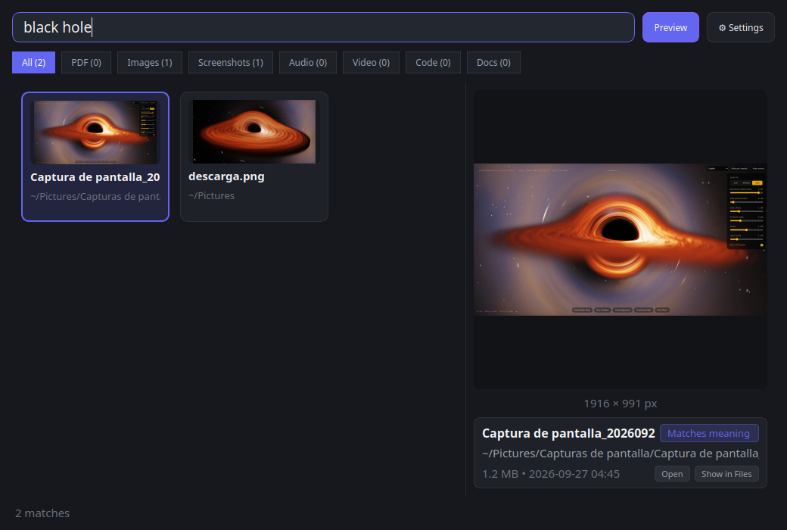
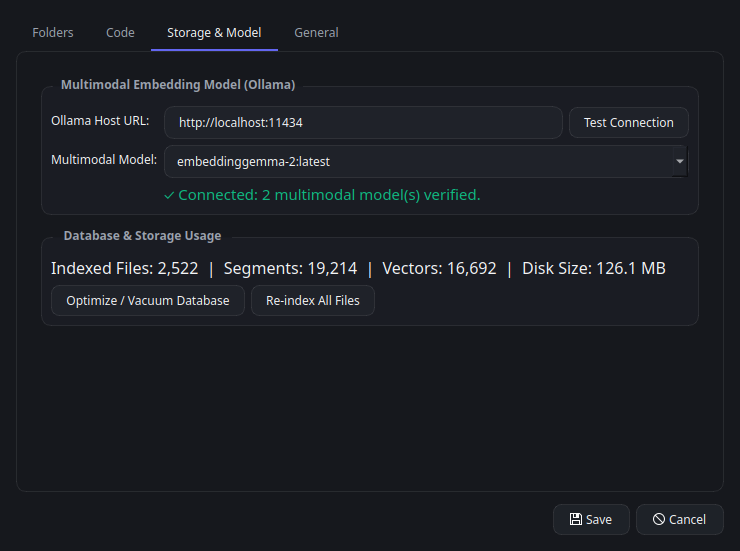

# SemSearch

**SemSearch** is a fast, 100% local, keyboard-driven **multimodal semantic search engine** for the Linux desktop. Find documents, PDFs, screenshots, photos, audio, videos, and source code by meaning—not just by filename.



> [!WARNING]
> **Ollama v0.40.4 or higher is required.** SemSearch relies on Ollama's native multimodal `/api/embed` capabilities introduced in `v0.40.4+` to generate unified embeddings across text, images, and audio. Please make sure your local Ollama installation is updated before running SemSearch.

---

## ✨ Highlights

- **True Cross-Modal Search:** Type `"black hole"` and immediately find screenshots or downloaded pictures of a black hole—even when the file is named `Captura de pantalla_20260927_044528.png` or `descarga.png` with zero matching text in the filename.
- **Powered by Ollama & Multimodal Embeddings:** Uses **`embeddinggemma-2`** by default via [Ollama](https://ollama.com), and supports **any other multimodal embedding model** available on your Ollama server. SemSearch automatically inspects and verifies installed models for multimodal embedding support.
- **Hybrid Lexical + Semantic Ranking:** Combines instant SQLite FTS5 keyword search with vector cosine similarity and modality-aware score normalization so exact keyword hits and conceptual matches both rank naturally.
- **Spotlight-Style Quick Search Panel:** Summon a floating search bar from anywhere on your desktop with `Ctrl+Shift+Space` (or `semsearch --panel`) for instant keyboard-first navigation and live previews.
- **Full Desktop Search Window:** Browse visual results in a responsive thumbnail card grid, filter by file category (`All`, `PDF`, `Images`, `Screenshots`, `Audio`, `Video`, `Code`, `Docs`), inspect rich interactive previews, and **drag and drop** any result card directly into other desktop applications.
- **Developer-Ready Source Code Search:** Prefix any query with `code:` (or switch to the **Code** tab) to search across your repositories with symbol-aware extraction and jump straight to the matching line in **VS Code**, **Cursor**, **Zed**, **Sublime Text**, or **JetBrains** IDEs.
- **100% Private & Offline:** Every file extraction, embedding vector, and database index stays strictly on your machine (`~/.local/share/semsearch/`). Sensitive files (`.env`, SSH keys, `.pem`, `.kdbx`, credentials) and heavy dependency directories (`node_modules`, `.venv`, `target`, `dist`) are automatically skipped.
- **Smart Background Indexing:** Real-time filesystem watcher keeps your index up to date automatically, with optional battery-saver policies and scheduled indexing windows.
- **23 Languages Supported:** Built-in localization for 23 languages (including full Right-to-Left layout support for Arabic, Persian, and Hebrew).

---

## 📸 Screenshots

### Floating Quick Search Panel (`Ctrl+Shift+Space`)
Instant pop-up launcher with grouped results and side-by-side live preview:


### Semantic Source Code Search (`code:`)
Search functions, classes, and implementation logic by concept with line-level preview and one-click IDE opening:


### Multimodal Model & Storage Settings
Connect to any local or remote Ollama instance, switch between verified multimodal embedding models, and manage your local index:



---

## 🚀 Getting Started

### 1. Prerequisites

1. **Linux Desktop** (Python `>= 3.11`, FFmpeg recommended for audio/video stream extraction).
2. **Ollama v0.40.4 or newer** running locally (`http://localhost:11434`) or on your network.

Pull the default **`embeddinggemma-2`** model (or any compatible multimodal embedding model):

```bash
ollama pull embeddinggemma-2
# Or pull a GGUF quantized variant directly from Hugging Face:
ollama pull hf.co/ggml-org/embeddinggemma-2-GGUF:BF16
```

### 2. Installation

You can install SemSearch directly from GitHub as an isolated CLI/desktop application using **`uv`** or **`pipx`**:

#### Using `uv` (recommended)
```bash
uv tool install git+https://github.com/arrase/semsearch.git
```

#### Using `pipx`
```bash
pipx install git+https://github.com/arrase/semsearch.git
```

#### From Source (Local Virtual Environment)
```bash
git clone https://github.com/arrase/semsearch.git
cd semsearch
uv venv
uv pip install -e .
```

### 3. Launch SemSearch

```bash
semsearch
```

On your first launch, a 5-step **Onboarding Wizard** will guide you through:
1. Selecting the folders you want to index (`Documents`, `Pictures`, `Desktop`, `Downloads`, or custom paths).
2. Verifying your **Ollama** connection and selecting your **multimodal embedding model** (`embeddinggemma-2` by default).
3. Optionally enabling **Source Code Search** and picking your preferred code editor.

---

## 🖥️ Usage & Keyboard Shortcuts

### CLI Commands

SemSearch runs as a single-instance desktop application with a system tray icon. Calling `semsearch` while an instance is already running forwards the command instantly via local IPC:

| Command | Description |
| :--- | :--- |
| `semsearch` or `semsearch --window` | Open the full desktop search window |
| `semsearch --panel` | Toggle the floating quick search panel |
| `semsearch --settings` | Open the settings dialog directly |
| `semsearch --daemon` | Start silently in the background (system tray & global hotkey only) |

### Quick Search Panel Shortcuts

Press **`Ctrl+Shift+Space`** at any time to toggle the floating panel:

| Shortcut | Action |
| :--- | :--- |
| `↑` / `↓` | Navigate through search results |
| `Enter` (`↵`) | Open selected file (at the exact PDF page, media timestamp, or code line) |
| `Shift + Enter` (`⇧↵`) | Reveal file in your system file manager |
| `Ctrl + C` (`⌃C`) | Copy file to clipboard |
| `Ctrl + O` (`⌃O`) | Switch to the Full Search Window |
| `Esc` | Clear search input or dismiss the panel |

### Full Search Window Shortcuts

| Shortcut | Action |
| :--- | :--- |
| `Ctrl + F` | Focus the search bar |
| `Ctrl + 1` … `Ctrl + 8` | Filter by category (`All`, `PDF`, `Images`, `Screenshots`, `Audio`, `Video`, `Code`, `Docs`) |
| `Double-Click` | Open result in default application or configured code editor |
| `Drag & Drop` | Drag any result card or code match directly into another app, browser, or email |

---

## 🧠 Multimodal Models & Supported File Types

### Flexible Multimodal Model Support
By default, SemSearch uses **`embeddinggemma-2`** via Ollama. However, **you are not locked into a single model**—you can use any multimodal embedding model supported by Ollama.

When you click **Test Connection** in **Settings → Storage & Model**, SemSearch queries your Ollama server (`/api/tags` and `/api/show`), inspects model capabilities and projector architectures, and populates the selector with all verified multimodal models installed on your system.

### Supported Formats

- **Documents (`Docs`):** `.txt`, `.md`, `.markdown`, `.rst`, `.rtf`, `.docx`, `.doc`, `.odt`, `.html`, `.htm`
- **PDFs (`PDF`):** `.pdf` (page-level text extraction + rendered visual page embeddings + interactive page viewer with keyword highlighting)
- **Images & Screenshots (`Images` / `Screenshots`):** `.png`, `.jpg`, `.jpeg`, `.webp`, `.gif`, `.bmp`, `.tiff`, `.avif`, `.svg` (automatic screenshot classification for desktop captures)
- **Audio (`Audio`):** `.mp3`, `.m4a`, `.wav`, `.aac`, `.flac`, `.ogg`, `.wma`, `.aiff` (chunked audio embeddings with interactive waveform scrubber)
- **Video (`Video`):** `.mp4`, `.mov`, `.mkv`, `.avi`, `.webm`, `.m4v`, `.wmv` (keyframe + audio segment indexing with frame preview and timestamp jumping)
- **Source Code (`Code`):** 60+ programming languages and build files (`.py`, `.rs`, `.go`, `.ts`, `.tsx`, `.js`, `.c`, `.cpp`, `.java`, `.kt`, `.swift`, `Dockerfile`, `Makefile`, etc.) stored in a dedicated `code.sqlite` index.

---

## ⚙️ Configuration & Data Storage

- **Configuration File:** `~/.config/semsearch/config.json`
- **Index Databases:** `~/.local/share/semsearch/index.sqlite` (general documents & media) and `~/.local/share/semsearch/code.sqlite` (source code)
- **Desktop Autostart:** Toggle *"Start SemSearch automatically on desktop login"* in **Settings → General** to manage `~/.config/autostart/semsearch.desktop`.
