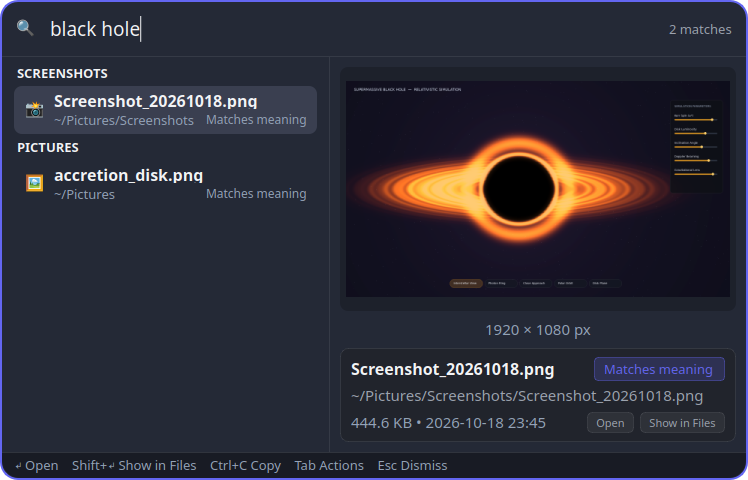
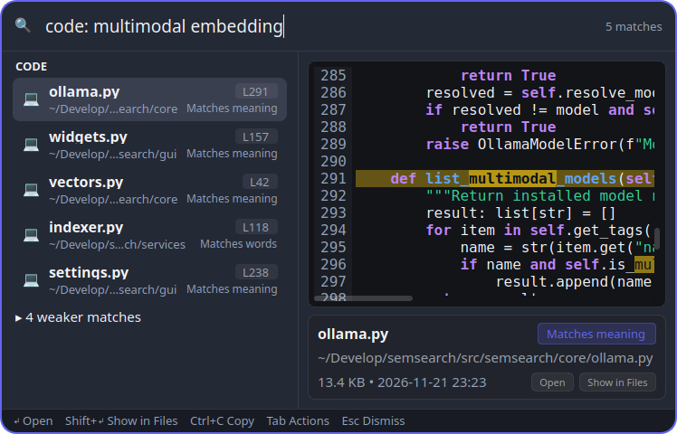
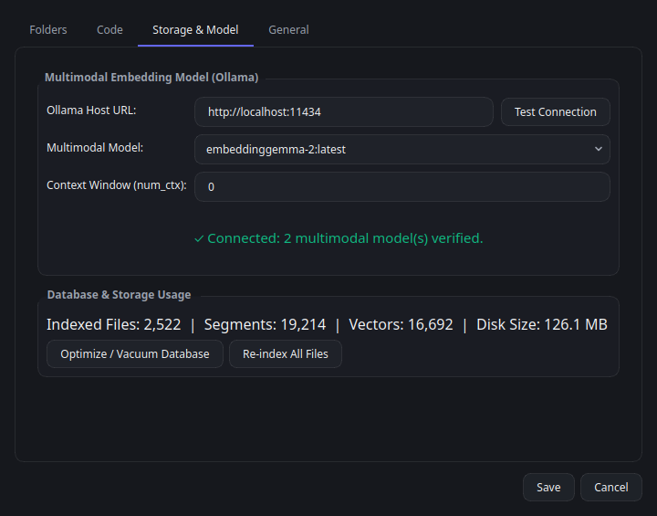

# SemSearch

**SemSearch** is a fast, 100% local, keyboard-driven **multimodal semantic search engine** for the Linux desktop. Find documents, PDFs, screenshots, photos, SVGs, audio, videos, and source code by meaning—not just by filename.

> [!WARNING]
> **Ollama v0.40.4 or higher is required.** SemSearch relies on Ollama's native multimodal `/api/embed` capabilities introduced in `v0.40.4+` to generate unified embeddings across text, images, and audio. Please make sure your local Ollama installation is updated before running SemSearch.

---

## ✨ Highlights

- **True Cross-Modal Search (Strict Zero-OCR):** Type `"black hole"` and immediately find screenshots, photos, or `.svg` diagrams of a black hole—even when the file is named `Captura de pantalla_20260927_044528.png` with zero matching text in the filename. Visual content is embedded directly without slow OCR engines.
- **Powered by Ollama & Multimodal Embeddings:** Uses **`embeddinggemma-2`** by default via [Ollama](https://ollama.com), and supports **any other verified multimodal embedding model** available on your Ollama server. Automatic model/dimension fingerprinting in SQLite `meta` handles model switches cleanly.
- **Hybrid BM25 + Semantic Ranking & Inline Filters:** Combines instant SQLite FTS5 BM25 keyword ranking, RAM-cached vector cosine similarity (`< 3 ms` lookups), modality-aware Z-score normalization, `camelCase` ↔ `snake_case` & CJK tokenization, and keyboard inline filters (`code:`, `kind:`, `ext:`, `path:`, `after:`).
- **Spotlight-Style Quick Search Panel (`748px`):** Summon a floating `748px` (`328px` list + `416px` preview) launcher from anywhere on your desktop with `Ctrl+Shift+Space` (automatic via Wayland XDG `GlobalShortcuts` portal or X11 `pynput`, or via `semsearch --toggle`) featuring asynchronous previews, in-panel audio playback, Drag & Drop, and a Quick Actions menu (`Tab` / `Ctrl+K`).
- **Composable Headless CLI & Native Desktop Search Providers:** Script and pipe results with `semsearch query "..." --json`, `semsearch status --json`, `semsearch reindex --force`, and register **KDE KRunner** (`org.kde.krunner1`) and **GNOME Shell** (`org.gnome.Shell.SearchProvider2`) search providers with `semsearch install-desktop`.
- **Developer-Ready Source Code Search:** Prefix any query with `code:` to search across your repositories with `.gitignore` awareness and symbol-definition anchoring, jumping straight to the matching line in **VS Code**, **Cursor**, **Zed**, **Sublime Text**, or **JetBrains** IDEs.
- **100% Private & Offline:** Every extraction, float16 vector, and SQLite WAL index stays strictly on your machine (`$XDG_DATA_HOME/semsearch/`, default `~/.local/share/semsearch/`). Sensitive directories (`.ssh`, `.gnupg`, `.aws`, `.kube`), secrets (`.env`, `.pem`, `.key`, `.kdbx`, `*.tfstate`, `kubeconfig`, `hosts.yml`), minified bundles, and dependency folders (`node_modules`, `.venv`, `target`, `dist`) are automatically skipped.
- **Smart Background Indexing & Resilience:** Selective non-recursive `inotify` watcher, atomic per-file SQLite WAL transactions, automatic backoff recovery if Ollama restarts, battery-saver policies (ignoring wireless peripheral batteries), scheduled indexing windows, and automatic VRAM unloading when idle.
- **23 Languages Supported:** Built-in lazy-loaded JSON localization for 23 languages (including full Right-to-Left layout support for Arabic, Persian, and Hebrew).

---

## 📸 Screenshots

### Floating Quick Search Panel (`Ctrl+Shift+Space`)
Instant pop-up launcher (`748px`: `328px` grouped results + `416px` live asynchronous preview):



### Semantic Source Code Search (`code:`)
Search functions, classes, and implementation logic by concept with syntax-highlighted line-level preview and one-click IDE opening:



### Multimodal Model & Storage Settings
Connect to any local or remote Ollama instance, switch between verified multimodal embedding models, optionally tune the context window size (`num_ctx`), and manage your local index:



---

## 🚀 Getting Started

### 1. Prerequisites

1. **Linux Desktop** (X11 or Wayland, Python `>= 3.11`, `ffmpeg`/`ffprobe` recommended for audio/video stream extraction and waveforms).
2. **Ollama v0.40.4 or newer** running locally (`http://localhost:11434`) or on your network.

Pull the default **`embeddinggemma-2`** model (or any compatible multimodal embedding model):

```bash
ollama pull embeddinggemma-2
# Or pull a GGUF quantized variant directly from Hugging Face:
ollama pull hf.co/ggml-org/embeddinggemma-2-GGUF:BF16
```

### 2. Installation

Install SemSearch directly from GitHub as an isolated CLI/desktop application using **`uv`** or **`pipx`**:

#### Using `uv` (recommended)
```bash
uv tool install git+https://github.com/arrase/semsearch.git
```

#### Using `pipx`
```bash
pipx install git+https://github.com/arrase/semsearch.git
```

#### From Source (Local Virtual Environment)
```bash
git clone https://github.com/arrase/semsearch.git
cd semsearch
uv venv
uv pip install -e .
```

### 3. Launch & Desktop Integration

```bash
# Install desktop launcher, SVG icon, D-Bus service, KRunner & GNOME search providers:
semsearch install-desktop

# Launch SemSearch (runs 5-step Onboarding Wizard on first start):
semsearch
```

On your first launch, the 5-step **Onboarding Wizard** discovers your existing XDG directories (`Documents`, `Pictures`, `Desktop`, `Downloads`), lets you verify your **Ollama** multimodal model, and optionally sets up **Source Code Search**. Once onboarded, launching `semsearch` docks silently to your system tray and listens for `Ctrl+Shift+Space`.

> [!NOTE]
> **GNOME Shell Search Provider:** `semsearch install-desktop` installs all descriptors in user space (`~/.local/share/`). On distributions where GNOME Shell only scans `/usr/share/gnome-shell/search-providers/`, create a single symlink:
> ```bash
> sudo ln -sf ~/.local/share/gnome-shell/search-providers/semsearch-search-provider.ini \
>   /usr/share/gnome-shell/search-providers/semsearch-search-provider.ini
> ```

---

## 🖥️ CLI, Inline Filters & Keyboard Shortcuts

### CLI Commands

GUI flags forward instantly over a user-private `AF_UNIX` socket (`$XDG_RUNTIME_DIR/semsearch/ipc.sock`) when an instance is already running, while subcommands execute directly without opening GUI windows:

| Command | Description |
| :--- | :--- |
| `semsearch` or `semsearch --daemon` | Start anchored in the system tray (runs Onboarding Wizard on first launch) |
| `semsearch --toggle` | Toggle the floating quick search panel (ideal universal Wayland/WM shortcut command) |
| `semsearch --panel` | Open and focus the floating quick search panel |
| `semsearch --settings` | Open the settings dialog directly |
| `semsearch query "<text>" [--code] [--kind K] [--limit 20] [--json]` | Run a headless search from the terminal or scripts (supports inline filters and JSON output) |
| `semsearch status [--json]` | Print index file/segment/vector counts, model fingerprint, and disk usage |
| `semsearch reindex [--force]` | Trigger a crawl/sync (or full reset + re-index with `--force`), via running daemon IPC or standalone |
| `semsearch install-desktop [--data-home PATH]` | Install `.desktop` entry, SVG icon, D-Bus service, KDE KRunner plugin, and GNOME Search Provider |

```bash
# Examples:
semsearch query "quarterly budget kind:pdf after:30d" --json
semsearch query "OllamaClient" --code --limit 10
semsearch status --json
```

### Inline Query Filters

Combine structured filters anywhere inside the Quick Search Panel or `semsearch query`:

| Filter | Examples | Effect |
| :--- | :--- | :--- |
| `code:` | `code: SearchService.lexical_search` | Route query exclusively to the dedicated `code.sqlite` source code index |
| `kind:` | `kind:pdf`, `kind:image,screenshot` | Restrict results by `FileKind` (`pdf`, `doc`/`docs`, `image`/`img`/`photo`, `screenshot`/`shot`, `audio`, `video`, `code`) |
| `ext:` | `ext:md`, `ext:py,rs` | Filter by file extension (comma-separated, with or without leading dot) |
| `path:` | `path:invoices`, `path:"tax 2026"` | Require case-insensitive path substring (repeatable; quote values with spaces) |
| `after:` | `after:7d`, `after:2w`, `after:6m`, `after:2026-01-01` | Restrict to files modified after a relative window (`d`/`w`/`m`) or ISO date (`YYYY-MM-DD`) |

Queries consisting solely of filters (e.g., `kind:pdf after:7d`) bypass Ollama completely and return matching files sorted by modification time.

### Wayland & X11 Global Shortcuts

- **Automatic Global Hotkey:** Under Wayland, SemSearch registers `Ctrl+Shift+Space` natively via the XDG Desktop Portal (`org.freedesktop.portal.GlobalShortcuts`, supported on KDE Plasma 6, GNOME 48+, and Hyprland). Under X11, it uses `pynput`. The active backend status is displayed in **Settings → General**.
- **Universal Compositor Fallback:** On any Wayland compositor or tiling WM (Sway, Hyprland, i3, GNOME, KDE), you can bind your preferred shortcut directly to `semsearch --toggle`.

### Quick Search Panel Shortcuts

Press **`Ctrl+Shift+Space`** (or trigger `semsearch --toggle`) at any time:

| Shortcut | Action |
| :--- | :--- |
| `↑` / `↓`, `PageUp` / `PageDown`, `Home` / `End` | Navigate search results and weaker matches |
| `Enter` (`↵`) | Open selected file at the exact PDF page, media timestamp, or code line |
| `Shift + Enter` / `Ctrl + Enter` | Reveal and highlight file in your system file manager |
| `Tab` / `Ctrl + K` | Open Quick Actions menu (Open, Show in Files, Copy File, Copy Path, Copy Excerpt, Open Terminal Here) |
| `Ctrl + C` | Copy selected query text if highlighted in the search box; otherwise copy the selected file to the clipboard |
| `Alt + ←` / `Alt + →` | Navigate to previous / next page when previewing a PDF |
| **Drag & Drop** | Drag any result row directly into a browser, chat app, editor, or file manager |
| `Esc` | Clear search input (collapsing the panel) or dismiss the panel if empty |

---

## 🧠 Multimodal Models & Supported File Types

### Flexible Multimodal Model Support, `num_ctx`, and Index Fingerprinting

By default, SemSearch uses **`embeddinggemma-2`** via Ollama, and supports any verified multimodal embedding model installed on your Ollama server:

- **Strict Multimodal Verification:** Clicking **Test Connection** in **Settings → Storage & Model** probes your Ollama host asynchronously using an isolated temporary client, querying `/api/tags` and `/api/show` and requiring the `"embedding"` capability alongside multimodal vision/audio support (excluding text-only embedders and generative chat VLMs like `llava`).
- **Context Window (`num_ctx`):** Leaving `num_ctx = 0` (the default) **omits** `options.num_ctx` from `/api/embed` requests so Ollama uses the model's real default context window without inflating KV-cache VRAM. Setting an explicit positive integer validates it against `/api/show`'s maximum `context_length` and passes `"options": {"num_ctx": ...}`.
- **Automatic Model Fingerprint & RAM Vector Cache:** Each SQLite database records `embedding_model` and `embedding_dim` in `meta`. Switching to a different model or vector dimension automatically clears stale vectors and schedules a clean re-index. During search, vectors are served from an immutable RAM `VectorSnapshot` cache invalidated by transaction generation counters for sub-3 ms similarity scoring across arbitrary vector dimensions.

### Supported Formats (Strict Zero-OCR)

- **Documents (`Docs`):** `.txt`, `.text`, `.md`, `.markdown`, `.rst`, `.rtf`, `.docx`, `.odt`, `.html`, `.htm` *(legacy binary OLE2 `.doc` is not supported; `.docx`/`.odt` enforce a 32 MiB zip-bomb limit and text files are bounded to 10 MiB)*
- **PDFs (`PDF`):** `.pdf` (two-stage page-level text extraction + visual page embeddings without OCR, interactive HiDPI page preview with yellow keyword highlights, controlled handling of encrypted PDFs)
- **Images & Screenshots (`Images` / `Screenshots`):** `.png`, `.jpg`, `.jpeg`, `.webp`, `.gif` (animated preview), `.bmp`, `.tiff`, `.tif`, `.avif`, `.svg` (natively rasterized via PyMuPDF, **Zero-OCR**), automatic screenshot classification (`.heic` is excluded by default via `excluded_types`)
- **Audio (`Audio`):** `.mp3`, `.m4a`, `.wav`, `.aac`, `.flac`, `.ogg`, `.wma`, `.aiff` (16 kHz mono windowed embeddings, real duration probing, in-panel `QMediaPlayer` playback and real RMS waveform)
- **Video (`Video`):** `.mp4`, `.mov`, `.mkv`, `.avi`, `.webm`, `.m4v`, `.wmv` (perceptually deduplicated keyframes + audio track indexing, cached thumbnail scrubbing, timestamp jumping)
- **Source Code (`Code`):** 60+ programming languages, build files (`Makefile`, `Dockerfile`, `Justfile`, etc.), and Jupyter notebooks (`.ipynb`) stored in a dedicated `code.sqlite` index.

---

## ⚙️ Configuration & Data Storage

- **Configuration File:** `~/.config/semsearch/config.json` (written atomically with `0o600` owner-only permissions)
- **Index Databases:** `$XDG_DATA_HOME/semsearch/index.sqlite` and `$XDG_DATA_HOME/semsearch/code.sqlite` (default `~/.local/share/semsearch/`, SQLite WAL schema v6)
- **Preview Thumbnail Cache:** `~/.cache/semsearch/thumbs/` (LRU-pruned, max 200 PNG frames)
- **Runtime IPC Socket & Lock:** `$XDG_RUNTIME_DIR/semsearch/ipc.sock` and `instance.lock` (`0o700` dir, `0o600` files)
- **Desktop Autostart:** Toggle *"Start SemSearch automatically on desktop login"* in **Settings → General** to manage `~/.config/autostart/semsearch.desktop`.
