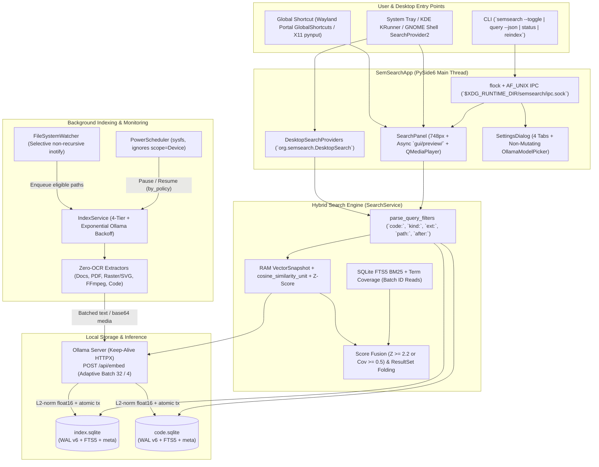

# System Architecture & Design

SemSearch is architected as a single-instance Linux desktop daemon and composable CLI built with **PySide6** (`QtWidgets`, `QtDBus`, `QtMultimedia`), **SQLite WAL (Schema v6) + FTS5**, **NumPy**, **HTTPX**, **Watchdog (`inotify`)**, and **Ollama**. It delivers sub-3 ms vector lookups and non-blocking UI previews while keeping all file contents and vector embeddings 100% local.

---

## High-Level Component Architecture

```
┌─────────────────────────────────────────────────────────────────────────┐
│             CLI / Global Shortcuts / Desktop Search Triggers            │
│ `semsearch [--toggle | --panel | --settings | --daemon]`                │
│ `semsearch {query | status | reindex | install-desktop}`                │
│ Wayland XDG GlobalShortcuts Portal | X11 pynput | KRunner | GNOME Shell │
└───────────────────────────────────┬─────────────────────────────────────┘
                                    │ AF_UNIX (`$XDG_RUNTIME_DIR/semsearch/ipc.sock`)
                                    │ + D-Bus (`org.semsearch.DesktopSearch`)
                                    ▼
┌─────────────────────────────────────────────────────────────────────────┐
│                 SemSearchApp (PySide6 Main Event Loop)                  │
│                                                                         │
│ ┌──────────────────┐ ┌─────────────────────┐ ┌────────────────────────┐ │
│ │ SystemTrayManager│ │     SearchPanel     │ │ DesktopSearchProviders │ │
│ │ (Event-Driven)   │ │ (748px + Async Prev)│ │ (KRunner + GNOME D-Bus)│ │
│ └────────┬─────────┘ └──────────┬──────────┘ └───────────┬────────────┘ │
└──────────┼──────────────────────┼────────────────────────┼──────────────┘
           │                      │                        │
           ▼                      ▼                        ▼
┌───────────────────────────┐ ┌───────────────────────────────────────────┐
│    Background Services    │ │               SearchService               │
│ - IndexService (4-Tier +  │ │ - Inline filters & `code:` routing        │
│   Ollama backoff)         │ │ - RAM VectorSnapshot + cosine_unit        │
│ - FileSystemWatcher       │ │ - Modality Z-Score + BM25 + Coverage      │
│   (Selective inotify)     │ │ - Batch DB reads & deferred snippets      │
│ - PowerScheduler (sysfs)  │ └────────────────────┬──────────────────────┘
└─────────────┬─────────────┘                      │
              │                                    │
              ├────────────────────┬───────────────┘
              ▼                    ▼
┌────────────────────────┐ ┌──────────────────────────────────────────────┐
│  OllamaClient (HTTPX)  │ │   Dual SQLite WAL v6 + FTS5 + RAM VecCache   │
│  Persistent keep-alive │ │  - $XDG_DATA_HOME/semsearch/index.sqlite     │
│  - GET  /api/tags      │ │  - $XDG_DATA_HOME/semsearch/code.sqlite      │
│  - POST /api/show      │ │  - Thread-local `?mode=ro` WAL readers       │
│  - POST /api/embed     │ │  - Atomic `BEGIN IMMEDIATE` write txns       │
│  - Adaptive batch 32/4 │ │  - `VectorSnapshot` RAM matrix cache         │
└────────────────────────┘ └──────────────────────────────────────────────┘
```

---

## 1. Single-Instance Daemon, `flock` Lock & `AF_UNIX` IPC

SemSearch runs as a persistent desktop process (`app.setQuitOnLastWindowClosed(False)`) coordinated by `SemSearchApp` (`gui/app.py`), registering desktop identity via `setDesktopFileName("semsearch")` and its scalable SVG application icon.

### Owner-Private Runtime Lock & Socket
Runtime IPC state lives in an owner-only directory (`$XDG_RUNTIME_DIR/semsearch`, falling back to `/tmp/semsearch_<uid>`, mode `0o700`):

1. **Exclusive Advisory Lock (`instance.lock`, `0o600`)**: The primary daemon acquires `fcntl.flock(fd, LOCK_EX | LOCK_NB)`, preventing duplicate daemons under race conditions.
2. **Local Domain Socket (`ipc.sock`, `0o600`)**: Hosted by `QLocalServer` configured with `QLocalServer.SocketOption.UserAccessOption`. Accepted `QLocalSocket` clients are scheduled for cleanup with `deleteLater()`.
3. **Zero-Qt Client Forwarding (`forward_ipc_command`)**: Secondary CLI invocations (`--toggle`, `--panel`, `--settings`, `--daemon`, `reindex [--force]`) connect directly using Python's `socket.AF_UNIX` (`1.0 s` timeout), write the command string (`TOGGLE`, `PANEL`, `SETTINGS`, `REINDEX`, `REINDEX_FORCE`, or `DAEMON`), and exit immediately with code `0` without initializing Qt.
4. **Clean Teardown (`shutdown()`)**: Unregisters D-Bus search providers, stops the hotkey listener, tray, scheduler, watcher, and indexer, joins any active crawl thread, shuts down `SearchPanel` and `SettingsDialog` background workers, closes `OllamaClient` and SQLite connections, removes `ipc.sock`, and unlocks `instance.lock`.

---

## 2. Dual SQLite WAL v6 Storage & RAM `VectorSnapshot` Cache

All indexed metadata, full-text tokens, and embedding vectors are stored under `$XDG_DATA_HOME/semsearch/` (default `~/.local/share/semsearch/`) in two isolated SQLite databases:

| Database File | Purpose | Indexed Content |
| :--- | :--- | :--- |
| `index.sqlite` | General personal files & media | Documents, PDFs, raster & `.svg` images, screenshots, audio clips, and videos. |
| `code.sqlite` | Developer source code index | 60+ programming languages, build manifests, and Jupyter notebooks (`.ipynb`). |

### Lock-Free WAL Readers & Nested Atomic Transactions (`core/database.py`)
Each `Database` instance separates writing and reading cleanly:

* **Write Connection (`_write_conn`)**: Guarded by a reentrant lock (`threading.RLock`). All mutations run inside `with db.transaction():`, issuing `BEGIN IMMEDIATE` on outermost entry, `COMMIT` on success, and automatic `ROLLBACK` on any `BaseException` (nested calls join the enclosing transaction safely).
* **Thread-Local Read Connections (`threading.local()`)**: File-backed databases open dedicated read-only WAL connections per thread (`?mode=ro`, `PRAGMA busy_timeout = 5000`, `PRAGMA query_only = ON`). UI searches and D-Bus providers never block behind background indexing writes. All thread-local connections are tracked and closed cleanly in `Database.close()`.
* **Idle Memory Release**: `Database.shrink_memory()` runs `PRAGMA shrink_memory;` when indexing finishes or the Quick Search Panel hides.

```sql
PRAGMA journal_mode = WAL;
PRAGMA synchronous = NORMAL;
PRAGMA foreign_keys = ON;
PRAGMA busy_timeout = 5000;
PRAGMA user_version = 6;
```

### Schema v6 & Automatic v5 → v6 Migration
Opening a v5 database automatically upgrades it in-place without data loss (`_migrate_schema`):

1. **`meta`**: Key-value store tracking `embedding_model` and `embedding_dim`. `sync_model_metadata(model, dim)` compares active settings against stored fingerprints and calls `reset_all_for_reindex()` atomically if the model or vector dimension changed.
2. **`files`**: Tracks `path`, `kind`, `size`, `mtime`, `inode`, `device`, `state` (`pending`, `done`, `partial`, `skipped`, `failed`), `detail`, `info` (JSON including `duration`, `repo`, `last_page`, `last_chunk`), and `indexed_at`. Indexed on `(device, inode)`, `(state, kind)`, and `(state, mtime DESC)`.
3. **`segments`**: Stores file segments (`name`, `chunk`, `page`, `page_image`, `image`, `audio`, `frame`, `lines`, `cells`) with `modality`, `loc`, `loc_end`, `excerpt`, **`focus`** (1-based symbol definition line), **`has_vec`** (indexed boolean flag for fast vector stats and queries), and raw `float16` `vec BLOB`.
4. **`fts` + `segments_fts_delete` Trigger**: An `fts5` virtual table (`name`, `body`, `original UNINDEXED`) with `tokenize = "porter unicode61 remove_diacritics 2 categories 'L* N* Co M*'"`. Deduplicates `original` when identical to normalized `body`, and automatically purges orphaned rows via `AFTER DELETE ON segments`.

### RAM `VectorSnapshot` Cache
Rather than reading and unpacking SQLite BLOBs on every search keystroke, `Database.get_vector_snapshot()` caches an immutable, read-only `VectorSnapshot` in RAM:

* Holds read-only NumPy arrays: `segment_ids (int64)`, `file_ids (int64)`, `modality_codes (uint8)`, `matrix (float32, shape N×dim)`, and `scale_mask (bool_)`.
* Dynamically detects embedding dimensionality (`dim = len(blob) // 2`)—supporting 512, 768, 1024, or any other model dimension—and skips inconsistent blobs.
* Synchronized via an atomic `_vec_generation` counter bumped only when a transaction modifying vectors commits, guaranteeing lock-free zero-copy similarity scoring (`cosine_similarity_unit`) in under 3 ms.

---

## 3. Persistent Ollama Client & Adaptive Batching (`core/ollama.py`)

* **Persistent Connection Pool**: Uses a single keep-alive `httpx.Client` closed cleanly on shutdown, with a normalized `base_url` setter that invalidates thread-safe model/context caches under `_cache_lock`.
* **Adaptive Batch Sizing**: Sends up to **32** items per `/api/embed` call for pure text batches and automatically drops to **4** items whenever a batch window includes Base64 image or audio dictionaries, preventing HTTP timeouts and VRAM spikes.
* **VRAM-Safe `num_ctx = 0` & Idle Unload**: When `num_ctx == 0`, `"options"` is omitted so Ollama uses the model's real default context window without inflating KV-cache VRAM. Once `IndexService` finishes indexing and enters `IDLE`, it calls `ollama.unload(model)` (`"keep_alive": 0`) to release GPU/RAM memory immediately.

---

## 4. Four-Tier Priority Indexer & Outage Resilience (`services/indexer.py`)

`IndexService` runs on `IndexerWorkerThread` and drains four priority queue tiers (`IndexQueueTier`):

| Tier | Priority | Selection Rule |
| :--- | :--- | :--- |
| **1. `NEW_FILES`** | Highest | Recently created or modified files pushed by `FileSystemWatcher` (up to 50 immediate items). |
| **2. `BACKFILL`** | High | Pending general documents, images, screenshots, audio, and standard PDFs in `index.sqlite`. |
| **3. `CODE`** | Normal | Pending source code files and notebooks in `code.sqlite` when `code_enabled` is true. |
| **4. `LONG_FILES`** | Low | Multi-stage large PDFs (> 30 pages per pass) and large documents (> 40 chunks per pass) in `FileState.PARTIAL`. |

### Key Pipeline Guarantees
* **Vector Preservation on Move/Rename**: `_upsert_candidate()` requeues an existing record only when `mtime` or `size` changes, keeping `DONE` segments and vectors intact after `mv`.
* **Atomic Per-File Commit**: Extraction and Ollama embedding execute outside `_write_lock`; all segment deletions, insertions (including `focus`), and state transitions commit inside a single `with target_db.transaction():`.
* **Zero Empty Embeddings**: Segments with `Modality.NONE` or blank/non-word payloads are never dispatched to `ollama.embed()`.
* **Resilient Ollama Outage Backoff**: Temporary `(OllamaConnectionError, OllamaTimeoutError)` failures do **not** mark files as `FAILED`. The worker sets `status.waiting_for = "Ollama"`, preserves queue order, and retries with cancellable exponential backoff (`2 s → 4 s → 8 s → … → 30 s`) interrupted immediately on `stop()`.
* **Event-Driven Zero-Wakeup Idle**: On entering `IDLE`, the worker unloads the Ollama model (if embeddings occurred), calls `shrink_memory()`, notifies `add_work_listener` subscribers (such as `SystemTrayManager`), and sleeps on `_work_event.wait()`.

---

## 5. Selective `inotify` Watcher & Device-Filtered Power Scheduler

### Selective Non-Recursive `FileSystemWatcher` (`services/watcher.py`)
* **Selective Directory Watches**: Schedules Linux `inotify` watches with `recursive=False` exclusively on eligible directories—skipping dot-folders (`.git`, `.venv`, `.ssh`), `SKIPPED_FOLDER_NAMES` (`node_modules`, `target`, `dist`, `__pycache__`), `.noindex`, and user `excluded_folders`—preventing kernel inotify descriptor exhaustion in large repositories. Newly created eligible subdirectories are watched dynamically.
* **Differential Debouncing**: **0.75 s** quiet window for general folders; **60 s** quiet window with a **600 s (10-minute)** maximum ceiling for code repositories.
* **Zero-Churn Moves**: `on_moved` updates DB paths in-place via `db.move_file()` and skips re-enqueuing whenever file size and `mtime` remain unchanged.
* **Zero-Wakeup Idle Sleep**: `WatcherDebounceThread` sleeps on `_wake_event.wait()` whenever all debounce buckets are empty.

### Device-Filtered `PowerScheduler` (`services/scheduler.py`)
* **Peripheral Battery Filtering**: Inspects `/sys/class/power_supply/*` and ignores devices whose `scope` equals `"Device"` (such as Bluetooth mice, keyboards, or headsets), evaluating only system batteries.
* **Independent Pause Channels**: Pauses and resumes `IndexService` using `by_policy=True`, kept strictly separate from manual user pauses (`by_policy=False`) triggered via the system tray menu.
* **Zero Polling When Inactive**: When both *"Index while on battery power"* is enabled and scheduled hours are disabled, `_run_loop()` blocks indefinitely on `_wake_event.wait()` with zero periodic wakeups until woken by Settings changes or shutdown.

---

## Complete Execution & Data Flow


