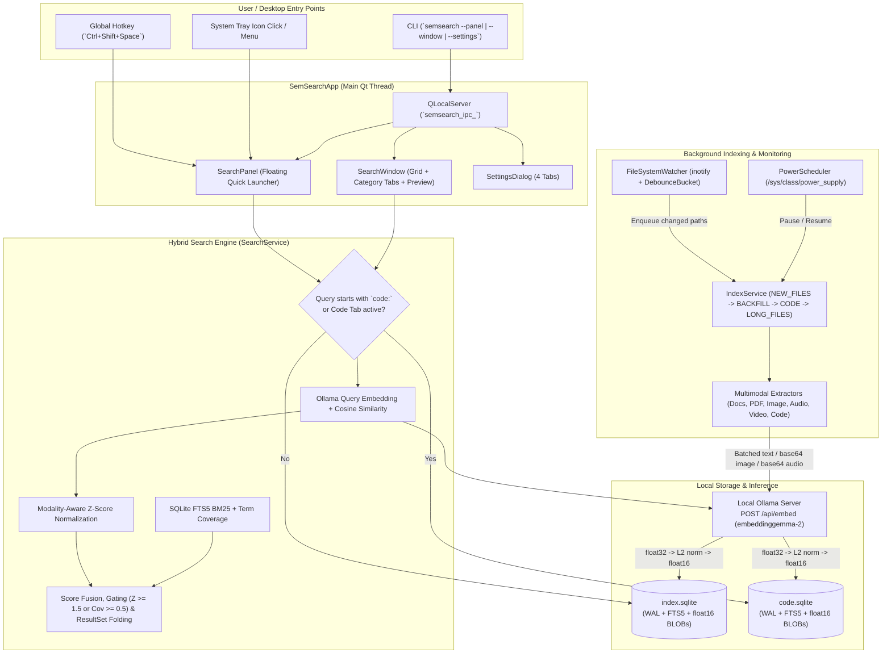

# System Architecture & Design

SemSearch is architected as a single-instance Linux desktop daemon built with **PySide6**, **SQLite WAL + FTS5**, **NumPy**, **Watchdog (`inotify`)**, and **Ollama**. It combines background multimodal indexing with sub-second interactive search while keeping all file contents and vector embeddings 100% local.

---

## High-Level Component Architecture

```
┌──────────────────────────────────────────────────────────────────────┐
│                   CLI / Global Hotkey Trigger                        │
│     `semsearch [--window | --panel | --settings | --daemon]`         │
│                  or Global Hotkey (Ctrl+Shift+Space)                 │
└───────────────────────────────────┬──────────────────────────────────┘
                                    │ QLocalSocket (`semsearch_ipc_<uid>`)
                                    ▼
┌──────────────────────────────────────────────────────────────────────┐
│                SemSearchApp (PySide6 Main Event Loop)                │
│                                                                      │
│  ┌──────────────────┐  ┌──────────────────┐  ┌────────────────────┐  │
│  │ SystemTrayManager│  │   SearchPanel    │  │    SearchWindow    │  │
│  │ (Dynamic QIcon)  │  │ (Quick Launcher) │  │ (Grid + Previews)  │  │
│  └────────┬─────────┘  └────────┬─────────┘  └─────────┬──────────┘  │
└───────────┼─────────────────────┼──────────────────────┼─────────────┘
            │                     │                      │
            ▼                     └──────────┬───────────┘
┌───────────────────────────┐                ▼
│   Background Services     │     ┌────────────────────────────────────┐
│ - IndexService (4-Tier)   │     │           SearchService            │
│ - FileSystemWatcher       │     │ - Dual routing (`index` vs `code`) │
│ - PowerScheduler (sysfs)  │     │ - Modality Z-Score + FTS5 Fusion   │
└─────────────┬─────────────┘     └──────────────────┬─────────────────┘
              │                                      │
              ├───────────────────┬──────────────────┘
              ▼                   ▼
┌───────────────────────┐ ┌────────────────────────────────────────────┐
│  OllamaClient (HTTPX) │ │      Dual SQLite WAL + FTS5 Databases      │
│  - GET /api/tags      │ │  - ~/.local/share/semsearch/index.sqlite   │
│  - POST /api/show     │ │  - ~/.local/share/semsearch/code.sqlite    │
│  - POST /api/embed    │ │  - float16 Vector BLOBs + Porter FTS5      │
└───────────────────────┘ └────────────────────────────────────────────┘
```

---

## 1. Single-Instance Daemon & Local Socket IPC

SemSearch runs as a persistent desktop process (`app.setQuitOnLastWindowClosed(False)`) coordinated by `SemSearchApp`.

### Named Unix Socket (`semsearch_ipc_<uid>`)
When `semsearch` is invoked from a terminal, application launcher, or desktop shortcut (`semsearch.main:main`):

1. It parses CLI flags (`--window`, `--panel`, `--settings`, `--daemon`) into an IPC command string (`SHOW_WINDOW`, `SHOW_PANEL`, `SHOW_SETTINGS`, or `DAEMON`).
2. `forward_ipc_command()` attempts to connect to the user-scoped Unix domain socket `semsearch_ipc_<uid>` via `QLocalSocket` with a 200 ms timeout.
3. **If an instance is already running:** The command string is written to the socket and the CLI process exits immediately with code `0`. The running daemon's `QLocalServer` reads the command and raises the requested window or toggles the quick search panel.
4. **If no instance is running:** `SemSearchApp` initializes the SQLite databases, background indexer, `inotify` watcher, power scheduler, global hotkey listener, and UI surfaces.

---

## 2. Dual SQLite WAL Storage Architecture

All indexed metadata, full-text tokens, and embedding vectors are stored under `~/.local/share/semsearch/` in two isolated SQLite databases:

| Database File | Purpose | Indexed Content |
| :--- | :--- | :--- |
| `index.sqlite` | General personal files & media | Documents, PDFs, images, screenshots, audio clips, and videos. |
| `code.sqlite` | Developer source code index | 60+ programming languages, build manifests, and Jupyter notebooks (`.ipynb`). |

### Database Pragmas & Concurrency
Each `Database` instance configures SQLite for concurrent background writes and low-latency UI reads, guarded by a re-entrant lock (`threading.RLock`):

```sql
PRAGMA journal_mode = WAL;
PRAGMA synchronous = NORMAL;
PRAGMA foreign_keys = ON;
PRAGMA busy_timeout = 5000;
PRAGMA user_version = 5;
```

### Core Schema (`SCHEMA_VERSION = 5`)
Each database maintains four coordinated structures:

1. **`meta`**: Key-value store tracking active model name and index metadata.
2. **`files`**: Tracks discovered files by `path`, `kind`, `size`, `mtime`, `inode`, `device`, `state` (`pending`, `indexed`, `skipped`, `failed`), and `indexed_at`. Indexed on `(device, inode)` for fast move/rename detection and `(state, kind)` for priority queue scheduling.
3. **`segments`**: Stores individual file segments (`name`, `chunk`, `page`, `page_image`, `image`, `audio`, `frame`, `lines`, `cells`) with their `modality` (`text`, `image`, `audio`), location offsets (`loc`, `loc_end`), preview `excerpt`, and raw `float16` embedding vector (`vec BLOB`, 1,536 bytes for 768-dim vectors).
4. **`fts`**: An `fts5` virtual table (`name`, `body`, `original UNINDEXED`) configured with `tokenize = "porter unicode61 remove_diacritics 2 categories 'L* N* Co M*'"` for stemmed, diacritic-insensitive lexical search.

---

## 3. Four-Tier Priority Indexing Pipeline

`IndexService` runs on a dedicated background daemon thread (`IndexerWorkerThread`) and processes pending files through four priority queue tiers (`IndexQueueTier`):

| Tier | Priority | Selection Rule |
| :--- | :--- | :--- |
| **1. `NEW_FILES`** | Highest | Recently created or modified files pushed by the real-time `inotify` watcher (up to 50 immediate items). |
| **2. `BACKFILL`** | High | Pending general documents, images, screenshots, audio, and standard PDFs in `index.sqlite`. |
| **3. `CODE`** | Normal | Pending source code files and notebooks in `code.sqlite`. |
| **4. `LONG_FILES`** | Low | Multi-stage large PDFs (> 30 pages) that have already had their first 30 pages indexed and are awaiting remaining page batches. |

### Immediate Filename Searchability
When `crawl_folder()` and `sync_candidates()` discover a file on disk, `Database.insert_file()` immediately inserts a `SegmentKind.NAME` segment and populates the `fts` index with the normalized filename and parent folder path. This makes newly discovered files **immediately searchable by filename** even before Ollama finishes generating their multimodal vectors.

---

## 4. Differential `inotify` Watcher & Power Scheduler

### Differential Debouncing (`FileSystemWatcher`)
Using `watchdog` (`inotify` on Linux), SemSearch monitors configured folders recursively with two separate `DebounceBucket` policies to prevent indexing storms during active editing or `git checkout` operations:

* **General Folders (`index.sqlite`)**: Quiet window of **0.75 seconds**.
* **Code Repositories (`code.sqlite`)**: Quiet window of **60 seconds** with a maximum ceiling of **600 seconds (10 minutes)**.
* **Move & Rename Tracking**: Moving a file or directory updates the existing `files` path and `fts` entry in-place (`db.move_file()`) without re-extracting or re-embedding unchanged content.

### Battery & Schedule Policies (`PowerScheduler`)
`PowerScheduler` polls every 10 seconds in a background thread:

* **Battery Detection**: Reads `/sys/class/power_supply/*/type` (`Battery`) and `/sys/class/power_supply/*/status` (`Discharging`). If *"Index while on battery power"* is disabled, `IndexService` automatically pauses with reason `"AC power"` and resumes when plugged back in.
* **Scheduled Hours**: Supports daytime or overnight windows (e.g., `22:00` to `07:00`). Outside the active window, background indexing pauses cleanly while search remains 100% available.

---

## Complete Execution & Data Flow


