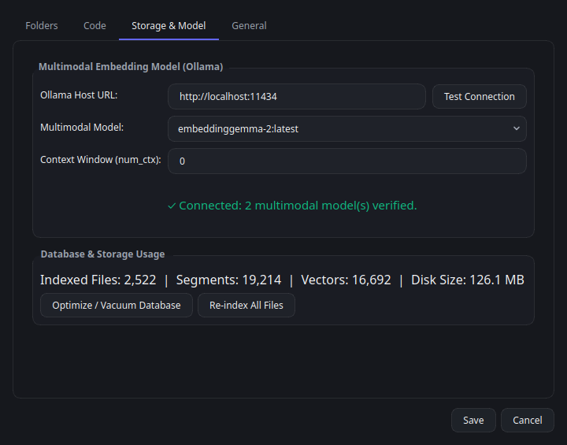

# Configuration, Models & Localization

SemSearch can be configured visually through its **5-Step Onboarding Wizard** on first launch, at any time via the **4-Tab Settings Dialog** (`semsearch --settings`), or by editing `$XDG_CONFIG_HOME/semsearch/config.json` (default `~/.config/semsearch/config.json`, or a custom file passed via `semsearch --config PATH`).

---

## 1. Five-Step First-Run Onboarding Wizard (`gui/onboarding.py`)

When `onboarded` is `false` in `config.json`, launching SemSearch opens `OnboardingWizard`:

1. **Welcome**: Overview of SemSearch's local multimodal architecture and 100% offline privacy guarantee.
2. **Select Folders to Index**: Dynamically discovers existing localized XDG standard directories (`Documents`, `Pictures`, `Desktop`, `Downloads`) via `QStandardPaths.writableLocation(...)`, skipping missing or home-equivalent entries, plus a shared `FolderListEditor` for custom folders and an initial crawl time estimate.
3. **Multimodal Embedding Model**: Configure your Ollama host URL (`http://localhost:11434`), click **Test Connection** to asynchronously discover verified multimodal embedding models via `OllamaModelPicker` (without mutating the active client), and select your model (`embeddinggemma-2` by default).
4. **Developer & Code Search**: Optional toggle to enable `code.sqlite`, pick code root directories, and choose your preferred IDE or editor (`Auto-detect`, `VS Code`, `Cursor`, `Zed`, `Sublime Text`, `JetBrains`, `Kate`, `Geany`, `Neovide`, `Emacs (emacsclient)`, or `Custom Command...`).
5. **Setup Complete**: Summary of your global shortcut (<kbd>Ctrl</kbd>+<kbd>Shift</kbd>+<kbd>Space</kbd>) and background indexing launch.

Cancelling or closing the onboarding wizard before completion exits cleanly via `SemSearchApp.shutdown()` without leaving an orphaned daemon running.

---

## 2. Four-Tab Settings Dialog (`gui/settings.py`)

Open Settings from the system tray menu or via `semsearch --settings`:



### Tab 1: Folders
* **Indexed Folders**: Add or remove directories monitored and indexed into `index.sqlite` (removing a folder automatically purges its orphaned entries on the next sync via `purge_outside_roots()`).
* **Exclusions**:
  * **Skipped Folders**: Comma-separated directory names or paths (e.g., `node_modules, .venv, target`).
  * **Skipped Extensions / Kinds**: Comma-separated file extensions or modality kinds excluded from general indexing (default: `heic`; supports extensions like `heic`, `gif` as well as modality kinds like `video`, `audio`, `image`, `screenshot`, `pdf`, `doc`, actively enforced during both crawling and watching).
  * **Max media duration (min, 0 = unlimited)**: Maximum audio/video duration in minutes (`max_media_duration_min`, default `60`, range `0`–`1440`; `0` disables the duration cap).
  * **Follow symbolic links**: Whether the crawler traverses symlinked files and directories (`follow_symlinks`, default `false`).
  * **Skip code repositories inside general folders**: Automatically skips repository roots inside general folders to keep `index.sqlite` focused on personal files (`skip_code_projects`, default `true`).
  * **Skip machine-generated dataset folders**: Skips bulk ML/dataset directories during general crawls (`skip_datasets`, default `true`).
* **Power & Indexing Schedule**:
  * **Index while on battery power**: Toggle whether `PowerScheduler` pauses indexing when `/sys/class/power_supply` reports a system battery discharging (wireless peripherals with `scope == "Device"` are ignored).
  * **Limit indexing to hours**: Restrict background indexing to a specific `HH:mm` window (supports overnight ranges such as `22:00` to `07:00`).

### Tab 2: Code
* **Enable Source Code Search**: Enables or cleanly closes the dedicated `code.sqlite` database and `code:` query routing.
* **Code Root Directories**: Add or remove root directories containing your software repositories.
* **Live re-index delay (seconds)**: Debounce quiet period before the file watcher re-indexes edited source files (`code_watch_delay_sec`, default `60`, range `1`–`3600`).
* **Preferred Code Editor**:
  * **Open code results with**: Choose `Auto-detect` (`auto`), `VS Code` (`code`), `Cursor` (`cursor`), `Zed` (`zed`), `Sublime Text` (`subl`), `JetBrains` (`jetbrains`), `Kate` (`kate`), `Geany` (`geany`), `Neovide` (`neovide`), `Emacs (emacsclient)` (`emacsclient`), or `Custom Command...` (`custom`).
  * **Custom editor command**: Shown when `Custom Command...` is selected (`custom_editor_cmd`). Supports `{file}` and `{line}` placeholders (e.g., `nvim-qt +{line} {file}`).

### Tab 3: Storage & Model
* **Multimodal Embedding Model (Ollama)** (`OllamaModelPicker` in `gui/widgets.py`):
  * **Ollama Host URL**: Local or LAN Ollama endpoint (default: `http://localhost:11434`).
  * **Test Connection**: Probes the entered host on a background thread using a short-lived temporary `OllamaClient`—never mutating the running daemon's active client before you click **Save**, never claiming a fake `"✓ Connected"` on dialog open, and always preserving your configured model selection.
  * **Multimodal Model**: Select from verified multimodal embedding models (default: `embeddinggemma-2`).
  * **Context Window (`num_ctx`)**: Optional token context window override. Leaving `num_ctx = 0` (the default) **omits** `options.num_ctx` from `/api/embed` requests so Ollama uses the model's real default context window without inflating KV-cache VRAM. Entering a positive integer validates it against `/api/show`'s maximum `context_length` before saving and sends `"options": {"num_ctx": <value>}`.
  * **VRAM Policy**: Controls `ollama_keep_alive` behavior:
    * **Unload when idle (saves VRAM)** (`unload_idle`, default): Sends `keep_alive: 0` to unload the model from VRAM once indexing and search go idle.
    * **Use Ollama server default** (`server`): Omits `keep_alive` so Ollama manages retention using its server default.
    * **Keep model loaded in VRAM** (`keep_loaded`): Sends `keep_alive: -1` to keep the model resident in VRAM for instant queries.
  * **Embedding Timeout (seconds)**: Request timeout for `/api/embed` and model preloads (`ollama_timeout`, default `120`, range `5`–`3600`).
  * **API Key**: Optional password-masked bearer token (`ollama_api_key`) for reverse-proxied or remote Ollama endpoints. When left empty, SemSearch automatically falls back to the `OLLAMA_API_KEY` environment variable if set.
* **Database & Storage Usage**:
  * **Index Directory**: Optional custom directory override (`data_dir`) with a **Browse...** button for storing `index.sqlite` and `code.sqlite` (leave empty to use the default `$XDG_DATA_HOME/semsearch`).
  * Displays live metrics across `index.sqlite` and `code.sqlite`: **Indexed Files**, **Segments**, **Vectors**, and total **Disk Size**.
  * **Optimize / Vacuum Database**: Runs `VACUUM` asynchronously off the UI thread (`_VacuumWorker`) to reclaim disk space without freezing Settings.
  * **Re-index All Files**: Invokes `reset_all_for_reindex()` (clearing all extracted non-name segments and resetting files to `pending`) followed by a full crawl and re-embedding pass.

### Tab 4: General
* **Global Shortcut**:
  * **Quick Search Shortcut**: Configure the desktop-wide hotkey (`ctrl+shift+space` by default, validated via `normalize_hotkey()`), with a live status indicator reporting the active backend (`Active (Wayland XDG GlobalShortcuts portal)`, `Active (X11 pynput)`, or a warning if unavailable).
  * **Hide search panel when clicking outside**: Auto-dismisses the floating Quick Search Panel when focus moves to another window (`close_on_focus_loss`, default `true`).
  * **Remember last search query on reopen**: Restores the previous search input when reopening the Quick Search Panel (`remember_last_query`, default `false`).
* **Appearance & Language**:
  * **Theme**: Choose `Dark` (`dark`, default), `Light` (`light`), or `System` (`system`, follows your desktop palette). Applies live across the Quick Search Panel and Settings dialog.
  * **Interface Language**: Choose `Auto-detect` or explicitly select any of the 23 supported languages. Updates take effect immediately across all UI surfaces (`retranslate_ui()`) and update RTL layout direction automatically.
* **Terminal**:
  * **Preferred Terminal**: Choose `Auto-detect` (`auto`), `xdg-terminal-exec`, `kitty`, `alacritty`, `ghostty`, `konsole`, `gnome-terminal`, `ptyxis`, `foot`, `wezterm`, `xfce4-terminal`, `tilix`, `cosmic-term`, `xterm`, or `Custom Command...` (`custom`) for the **Open Terminal Here** quick action.
  * **Custom terminal command**: Shown when `Custom Command...` is selected (`custom_terminal_cmd`). Supports the `{dir}` placeholder (e.g., `my-terminal --cwd {dir}`).
* **System Startup**: Toggle *"Start SemSearch automatically on desktop login"* to manage `$XDG_CONFIG_HOME/autostart/semsearch.desktop` (`Exec="<path>" --daemon`).

---

## 3. Verified Multimodal Model Discovery, Prompt Formatting & Fingerprinting (`core/ollama.py`)

When `OllamaClient.is_multimodal()` evaluates models installed on your Ollama server, it verifies capabilities via `POST /api/show`:

1. **Mandatory `"embedding"` Capability**: Models whose `capabilities` list does not include `"embedding"` are strictly rejected—filtering out generative vision-language chat models such as `llava` or `bakllava`.
2. **Multimodal Verification**: Once `"embedding"` is confirmed, models reporting `"vision"` or `"audio"` capabilities, multimodal families/architectures (`clip`, `mllama`, `gemma-embedding2`, `vision`, `audio`, `embeddinggemma`), projector keys (`clip.*`, `mllama.*`, `vision.*`, `audio.*`, `*projector*`), or matching embedding indicators are accepted.
3. **Model-Aware Prompt Formatting**: `OllamaClient.uses_gemma_prompts()` inspects the model tag and `/api/show` metadata (`family`/`families` and `general.architecture`). EmbeddingGemma task and document prefixes (`task: search result | query: ...`, `task: code retrieval | query: ...`, `title: ... | text: ...`) are applied automatically only for Gemma embedding models via `format_query_for_model()` and `format_doc_for_model()`. Non-Gemma multimodal architectures (such as CLIP-based or other vision/audio embedders) receive clean, unprefixed query text and plain title/text document inputs.
4. **Automatic Model & Dimension Fingerprinting (`meta`)**: Each SQLite database stores `embedding_model` and `embedding_dim` in its `meta` table. Whenever you switch to a different model or vector dimension, `Database.sync_model_metadata()` detects the mismatch automatically, clears stale segments/vectors via `reset_all_for_reindex()`, and re-embeds your index cleanly.

---

## 4. XDG Directories, CLI Override & Atomic JSON Reference (`config.json`)

SemSearch follows the XDG Base Directory Specification across all configuration, index, cache, and runtime files:

* **Configuration File**: `$XDG_CONFIG_HOME/semsearch/config.json` (default `~/.config/semsearch/config.json`). Pass `--config PATH` to any CLI invocation (`semsearch --config /path/to/config.json ...`) to load and persist an alternate configuration file for both GUI modes and headless subcommands (`query`, `status`, `reindex`).
* **Desktop Autostart**: `$XDG_CONFIG_HOME/autostart/semsearch.desktop` (default `~/.config/autostart/semsearch.desktop`).
* **Index Databases**: `$XDG_DATA_HOME/semsearch/` (default `~/.local/share/semsearch/`), or the custom path configured in `data_dir`.
* **Preview Thumbnail Cache**: `$XDG_CACHE_HOME/semsearch/thumbs/` (default `~/.cache/semsearch/thumbs/`).
* **Runtime IPC Socket & Lock**: `$XDG_RUNTIME_DIR/semsearch/ipc.sock` and `instance.lock`.

`ConfigManager` (`config.py`) manages persistence safely:

* **Atomic Owner-Only Saves**: `ConfigManager.save()` writes to `.config.json.tmp`, sets `0o600` permissions, and atomically replaces `config.json` via `Path.replace()`.
* **Resilient Loading & Validation**: If `config.json` is missing, truncated, invalid UTF-8, or contains mistyped values, out-of-range integers, unsupported enum values, or unknown keys, `ConfigManager.load()` cleanly falls back to `AppConfig()` defaults for affected fields without crashing.

```json
{
  "folders": [
    "/home/username/Documents",
    "/home/username/Pictures"
  ],
  "excluded_folders": [],
  "excluded_types": [
    "heic"
  ],
  "code_enabled": true,
  "code_folders": [
    "/home/username/Develop"
  ],
  "code_editor": "auto",
  "ollama_url": "http://localhost:11434",
  "model": "embeddinggemma-2",
  "num_ctx": 0,
  "hotkey": "ctrl+shift+space",
  "language": "auto",
  "index_on_battery": true,
  "index_schedule_enabled": false,
  "index_schedule_start": 1320,
  "index_schedule_end": 420,
  "onboarded": true,
  "data_dir": "",
  "follow_symlinks": false,
  "skip_code_projects": true,
  "skip_datasets": true,
  "max_media_duration_min": 60,
  "code_watch_delay_sec": 60,
  "ollama_keep_alive": "unload_idle",
  "ollama_timeout": 120,
  "ollama_api_key": "",
  "custom_editor_cmd": "",
  "terminal": "auto",
  "custom_terminal_cmd": "",
  "theme": "dark",
  "close_on_focus_loss": true,
  "remember_last_query": false
}
```

| Field | Type | Default | Description |
| :--- | :--- | :--- | :--- |
| `folders` | `list[str]` | `[]` | General directories indexed into `index.sqlite`. |
| `excluded_folders` | `list[str]` | `[]` | Folder names or paths skipped during crawling and watching. |
| `excluded_types` | `list[str]` | `["heic"]` | File extensions or modality kinds (`video`, `audio`, `image`, `screenshot`, `pdf`, `doc`) skipped in general mode. |
| `code_enabled` | `bool` | `false` | Enables source code indexing in `code.sqlite`. |
| `code_folders` | `list[str]` | `[]` | Root directories scanned for source code repositories. |
| `code_editor` | `str` | `"auto"` | Editor used for line-level code jumps (`auto`, `code`, `cursor`, `zed`, `subl`, `jetbrains`, `kate`, `geany`, `neovide`, `emacsclient`, `custom`). |
| `ollama_url` | `str` | `"http://localhost:11434"` | Base URL of the Ollama server. |
| `model` | `str` | `"embeddinggemma-2"` | Verified multimodal embedding model tag. |
| `num_ctx` | `int` | `0` | Optional token context window (`0` omits `options.num_ctx`, using Ollama's model default without inflating VRAM). |
| `hotkey` | `str` | `"ctrl+shift+space"` | Global keyboard shortcut combination. |
| `language` | `str` | `"auto"` | UI language code (`auto` or ISO 639-1 code). |
| `index_on_battery` | `bool` | `true` | Allow indexing while system battery is discharging. |
| `index_schedule_enabled` | `bool` | `false` | Restrict indexing to `[index_schedule_start, index_schedule_end)`. |
| `index_schedule_start` | `int` | `1320` (`22:00`) | Start time in minutes from midnight (`0`–`1439`). |
| `index_schedule_end` | `int` | `420` (`07:00`) | End time in minutes from midnight (`0`–`1439`). |
| `onboarded` | `bool` | `false` | Whether the initial onboarding wizard has been completed. |
| `data_dir` | `str` | `""` | Custom directory for `index.sqlite` and `code.sqlite` (empty uses `$XDG_DATA_HOME/semsearch`). |
| `follow_symlinks` | `bool` | `false` | Traverse symbolic links during crawling. |
| `skip_code_projects` | `bool` | `true` | Skip detected code repositories inside general indexed folders. |
| `skip_datasets` | `bool` | `true` | Skip machine-generated dataset folders during general indexing. |
| `max_media_duration_min` | `int` | `60` | Maximum audio/video duration in minutes (`>= 0`; `0` means unlimited). |
| `code_watch_delay_sec` | `int` | `60` | Debounce delay in seconds (`>= 1`) before live re-indexing modified code files. |
| `ollama_keep_alive` | `str` | `"unload_idle"` | VRAM retention policy: `unload_idle`, `server`, or `keep_loaded`. |
| `ollama_timeout` | `int` | `120` | Embedding request timeout in seconds (`>= 5`). |
| `ollama_api_key` | `str` | `""` | Optional Bearer token for authenticated Ollama endpoints (falls back to `OLLAMA_API_KEY`). |
| `custom_editor_cmd` | `str` | `""` | Custom editor command template used when `code_editor` is `"custom"` (supports `{file}`, `{line}`). |
| `terminal` | `str` | `"auto"` | Preferred terminal emulator (`auto`, `xdg-terminal-exec`, `kitty`, `alacritty`, `ghostty`, `konsole`, `gnome-terminal`, `ptyxis`, `foot`, `wezterm`, `xfce4-terminal`, `tilix`, `cosmic-term`, `xterm`, `custom`). |
| `custom_terminal_cmd` | `str` | `""` | Custom terminal command template used when `terminal` is `"custom"` (supports `{dir}`). |
| `theme` | `str` | `"dark"` | UI color theme: `dark`, `light`, or `system`. |
| `close_on_focus_loss` | `bool` | `true` | Hide the Quick Search Panel automatically when clicking outside it. |
| `remember_last_query` | `bool` | `false` | Restore the last search query when reopening the Quick Search Panel. |

---

## 5. Lazy JSON Internationalization (23 Languages & RTL)

SemSearch stores its 22 non-English translation catalogs as compact JSON files under `src/semsearch/i18n/locales/<lang>.json` loaded lazily on demand (`load_catalog(lang)`) and cached solely for the active language (with English served inline, 23 languages total).

`detect_system_language()` inspects `LC_ALL`, `LC_MESSAGES`, `LANGUAGE`, and `LANG` in order—walking colon-separated `LANGUAGE` fallback lists (e.g., `LANGUAGE="ca:es:en"` resolves to `es`) before falling back to `LANG` / `locale.getlocale()` / `en`.

| Code | Language | Code | Language | Code | Language |
| :--- | :--- | :--- | :--- | :--- | :--- |
| `en` | English | `ar` | العربية *(RTL)* | `ms` | Bahasa Melayu |
| `es` | Español | `tr` | Türkçe | `tl` | Tagalog (`fil`) |
| `fr` | Français | `fa` | فارسی *(RTL)* | `ru` | Русский |
| `de` | Deutsch | `he` | עברית *(RTL)* | `uk` | Українська |
| `it` | Italiano | `id` | Bahasa Indonesia (`in`) | `be` | Беларуская |
| `pt` | Português | `vi` | Tiếng Việt | `bg` | Български |
| `nl` | Nederlands | `th` | ไทย | `sr` | Српски |
| `pl` | Polski | | | `kk` | Қазақша |

When an RTL language (`ar`, `fa`, `he`) is active, `SemSearchApp` sets `Qt.LayoutDirection.RightToLeft` across the application, and `SearchPanel` adapts list divider borders and collapse arrows accordingly.
