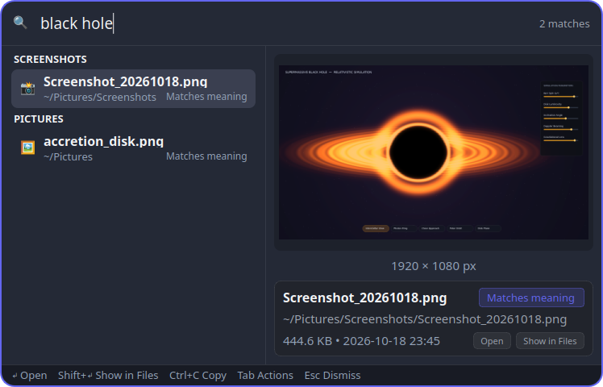
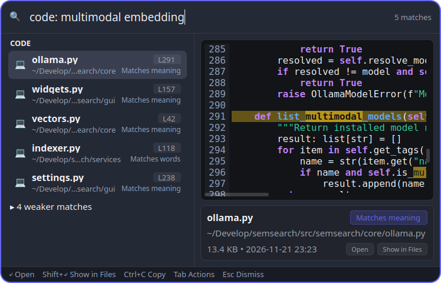
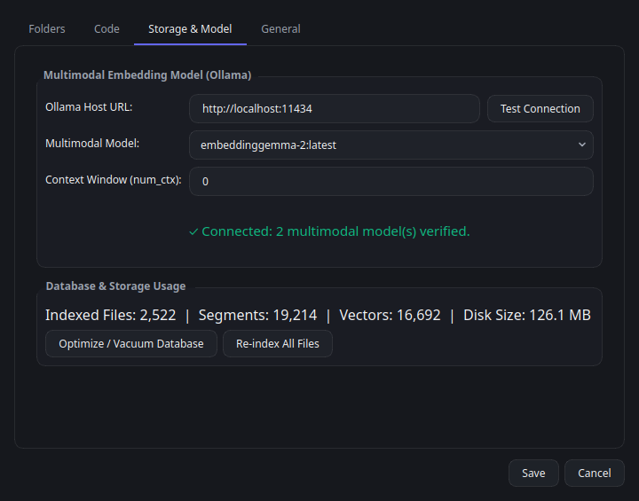

---
hide:
  - toc
---

  

    <i class="fa-solid fa-magnifying-glass-chart" aria-hidden="true"></i>
    Local Multimodal Semantic Search
  

  <h1>SemSearch</h1>
  
A fast, 100% local, keyboard-driven multimodal semantic search engine for the Linux desktop. Find documents, PDFs, screenshots, photos, SVGs, audio recordings, videos, and source code by meaning using unified Ollama embeddings—with strict Zero-OCR.

  

    
    
    
    
    
    
  

!!! warning "Ollama v0.40.4+ Required"
    SemSearch relies on Ollama's native multimodal `/api/embed` endpoint introduced in `v0.40.4+` to generate unified embeddings across text, images, and audio. Make sure your local Ollama installation is updated before running SemSearch.

  <h2>Key Features</h2>
  Cross-modal retrieval, Wayland integration &amp; asynchronous desktop previews

  

    <i class="fa-solid fa-wand-magic-sparkles feature-icon" aria-hidden="true"></i>
    <h3>True Cross-Modal Search (Zero-OCR)</h3>
    
Type <code>"black hole"</code> and immediately find screenshots, photos, or <code>.svg</code> diagrams of a black hole—even when named <code>Captura de pantalla_20260927.png</code> with zero matching text in the filename.

  

  

    <i class="fa-solid fa-brain feature-icon" aria-hidden="true"></i>
    <h3>Multimodal Ollama Embeddings</h3>
    
Uses <code>embeddinggemma-2</code> by default via a persistent <code>httpx</code> client, strict <code>"embedding"</code> capability verification, VRAM-safe default <code>num_ctx = 0</code>, and automatic model/dimension fingerprinting in <code>meta</code>.

  

  

    <i class="fa-solid fa-scale-balanced feature-icon" aria-hidden="true"></i>
    <h3>Hybrid BM25 + RAM Vector Ranking</h3>
    
Combines SQLite FTS5 BM25 rank, coverage, RAM-cached <code>VectorSnapshot</code> similarity, modality-aware Z-scores (<code>Z &gt;= 2.2</code>), <code>camelCase</code>/CJK support, and inline filters (<code>kind:</code>, <code>ext:</code>, <code>path:</code>, <code>after:</code>).

  

  

    <i class="fa-solid fa-bolt feature-icon" aria-hidden="true"></i>
    <h3>Spotlight-Style Quick Panel (748px)</h3>
    
Summon anywhere with <kbd>Ctrl</kbd>+<kbd>Shift</kbd>+<kbd>Space</kbd> (Wayland XDG <code>GlobalShortcuts</code> portal or X11) or <code>semsearch --toggle</code>, complete with Drag &amp; Drop and Quick Actions (<kbd>Tab</kbd> / <kbd>Ctrl</kbd>+<kbd>K</kbd>).

  

  

    <i class="fa-solid fa-eye feature-icon" aria-hidden="true"></i>
    <h3>Async Previews &amp; In-Panel Playback</h3>
    
Non-blocking <code>gui/preview/</code> loaders with cached video frames, in-panel <code>QMediaPlayer</code> audio playback &amp; real RMS waveforms, HiDPI PDFs (<kbd>Alt</kbd>+<kbd>←</kbd>/<kbd>→</kbd>), animated GIFs/SVGs, and syntax-highlighted code.

  

  

    <i class="fa-solid fa-terminal feature-icon" aria-hidden="true"></i>
    <h3>Composable CLI &amp; KRunner / GNOME</h3>
    
Script with <code>semsearch query --json</code>, <code>status</code>, and <code>reindex --force</code>, and integrate natively into <strong>KDE KRunner</strong> and <strong>GNOME Shell</strong> search via <code>semsearch install-desktop</code>.

  

  

    <i class="fa-solid fa-code feature-icon" aria-hidden="true"></i>
    <h3>Developer Source Code Search</h3>
    
Prefix queries with <code>code:</code> for <code>.gitignore</code>-aware symbol retrieval across 60+ languages and jump straight to the definition line in VS Code, Cursor, Zed, Sublime, or JetBrains IDEs.

  

  

    <i class="fa-solid fa-shield-halved feature-icon" aria-hidden="true"></i>
    <h3>100% Private, Hardened &amp; Resilient</h3>
    
Atomic <code>0600</code> config and IPC sockets, automatic exclusion of <code>.ssh</code>/<code>.aws</code>/<code>.kube</code>/secrets and zip bombs, Ollama outage backoff without marking files failed, and selective non-recursive <code>inotify</code> watches.

  

  

    <i class="fa-solid fa-language feature-icon" aria-hidden="true"></i>
    <h3>23 Languages &amp; RTL Support</h3>
    
Lazy-loaded JSON localization catalogs for 23 languages with colon-separated <code>LANGUAGE</code> fallback detection and full Right-to-Left (RTL) layout adaptation for Arabic, Persian, and Hebrew.

  

  <h2>Interface Gallery</h2>
  Quick search panel, code search &amp; model settings

### Floating Quick Search Panel (`Ctrl+Shift+Space`)
Instant pop-up launcher (`748px`: `328px` grouped results + `416px` live asynchronous preview):

### Semantic Source Code Search (`code:`)
Search functions, classes, and implementation logic by concept with syntax-highlighted line-level preview and one-click IDE opening:

### Multimodal Model & Storage Settings
Connect to any local or remote Ollama instance, switch between verified multimodal embedding models, optionally configure `num_ctx`, and manage your local index:

  <h2>Documentation</h2>
  Deep dive into architecture, ranking, extractors &amp; desktop integration

  <a href="architecture/" class="feature-card">
    

      <i class="fa-solid fa-sitemap feature-icon" aria-hidden="true"></i>
      Read →
    

    <h3>Architecture &amp; Design</h3>
    
Explore the single-instance daemon with <code>flock</code> + <code>AF_UNIX</code> IPC, SQLite WAL v6 thread-local readers, RAM <code>VectorSnapshot</code> cache, Ollama backoff resilience, and selective <code>inotify</code> watcher.

  </a>

  <a href="search-engine/" class="feature-card">
    

      <i class="fa-solid fa-magnifying-glass-chart feature-icon" aria-hidden="true"></i>
      Read →
    

    <h3>Hybrid Search &amp; Ranking</h3>
    
Deep dive into inline filter parsing, BM25 + coverage + modality-aware Z-score fusion (<code>Z &gt;= 2.2</code>), <code>camelCase</code>/CJK tokenization, qualified symbol resolution, and batch retrieval.

  </a>

  <a href="extractors/" class="feature-card">
    

      <i class="fa-solid fa-layer-group feature-icon" aria-hidden="true"></i>
      Read →
    

    <h3>Multimodal Extractors</h3>
    
Learn how documents (with zip-bomb guards), two-stage PDFs, raster &amp; PyMuPDF-rasterized <code>.svg</code> images, bounded FFmpeg media, and code/notebooks are extracted with strict Zero-OCR.

  </a>

  <a href="interfaces/" class="feature-card">
    

      <i class="fa-solid fa-desktop feature-icon" aria-hidden="true"></i>
      Read →
    

    <h3>Desktop UI &amp; Shortcuts</h3>
    
Guide to the <code>748px</code> Floating Quick Search Panel, event-driven system tray, modular async <code>gui/preview/</code> renderers, Drag &amp; Drop, Quick Actions, and KRunner / GNOME D-Bus providers.

  </a>

  <a href="configuration/" class="feature-card">
    

      <i class="fa-solid fa-sliders feature-icon" aria-hidden="true"></i>
      Read →
    

    <h3>Configuration &amp; Models</h3>
    
Reference for the 4-tab Settings dialog, XDG Onboarding Wizard, strict multimodal model verification, VRAM-safe <code>num_ctx</code>, atomic <code>config.json</code>, and lazy JSON i18n.

  </a>

  <a href="installation/" class="feature-card">
    

      <i class="fa-solid fa-download feature-icon" aria-hidden="true"></i>
      Read →
    

    <h3>Installation &amp; CLI Setup</h3>
    
Step-by-step instructions for Ollama, installing SemSearch, headless CLI subcommands, Wayland XDG <code>GlobalShortcuts</code> &amp; <code>--toggle</code>, and KRunner / GNOME provider setup.

  </a>

