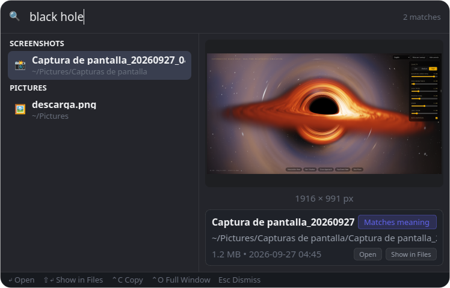
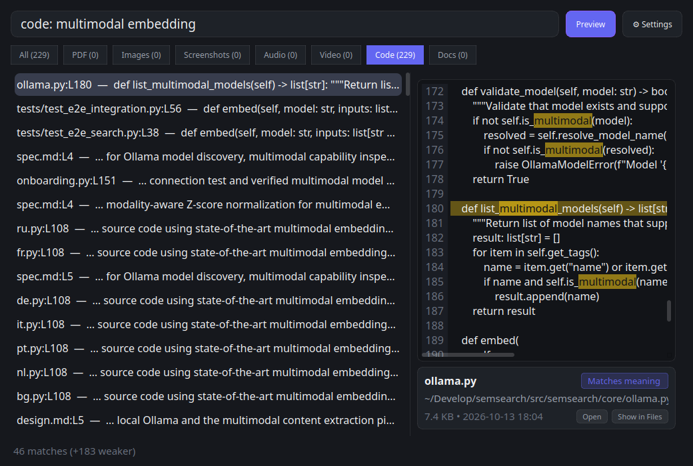

# Desktop UI, Quick Panel & Shortcuts

SemSearch provides three desktop interaction surfaces built with **PySide6**: a dynamic **System Tray Icon**, a Spotlight-style **Floating Quick Search Panel**, and a **Full Desktop Search Window** with rich interactive previews and deep-link opening.

---

## 1. Dynamic System Tray Icon (`gui/tray.py`)

`SystemTrayManager` renders a custom $64 \times 64$ antialiased `QPixmap` in memory using `QPainter` (`render_tray_icon`) that reflects the real-time state of `IndexService`:

| State | Visual Indicator | Tooltip / Menu Status |
| :--- | :--- | :--- |
| **Idle** | Brand purple-blue magnifying glass icon | `SemSearch - Idle - {N} indexed` |
| **Indexing** | Circular dark track with animated green progress arc (`0%`–`100%`) and center dot | `SemSearch - Indexing: {percent}% ({indexed}/{total})` |
| **Paused** | Amber circle with dual vertical pause bars | `SemSearch - Paused` |

### Tray Interactions
* **Left-Click**: Immediately toggles the floating **Quick Search Panel**.
* **Right-Click Context Menu**:
  * Status indicator line *(read-only)*
  * **Quick Search**: Opens the floating search bar.
  * **Search Window**: Opens the full desktop search window.
  * **Pause Indexing / Resume Indexing**: Manually pauses or resumes background indexing.
  * **Settings...**: Opens the 4-tab Settings dialog.
  * **Quit**: Stops background threads cleanly and exits SemSearch.

---

## 2. Floating Quick Search Panel (`gui/panel.py`)

Pressing <kbd>Ctrl</kbd>+<kbd>Shift</kbd>+<kbd>Space</kbd> (or running `semsearch --panel`) summons a frameless, centered floating search bar with live debounced search (`SearchWorker` thread) and a side-by-side preview pane.

### Quick Search Panel Keyboard Shortcuts

| Shortcut | Action |
| :--- | :--- |
| <kbd>Ctrl</kbd> + <kbd>Shift</kbd> + <kbd>Space</kbd> | Toggle the Quick Search Panel from anywhere on the desktop |
| <kbd>↑</kbd> / <kbd>↓</kbd> | Navigate up and down through ranked search results |
| <kbd>Enter</kbd> (`↵`) | Open selected result at the exact PDF page, media timestamp, or code line |
| <kbd>Shift</kbd> + <kbd>Enter</kbd> (`⇧↵`) | Reveal and highlight the file in your system file manager |
| <kbd>Ctrl</kbd> + <kbd>C</kbd> (`⌃C`) | Copy the file (`file://` URI) to the system clipboard |
| <kbd>Ctrl</kbd> + <kbd>O</kbd> (`⌃O`) | Transfer current query to the **Full Search Window** |
| <kbd>Esc</kbd> | Clear the search input or dismiss the panel |

---

## 3. Full Desktop Search Window (`gui/window.py`)

Running `semsearch` (or `semsearch --window`) opens the full desktop interface featuring category filter tabs, a responsive thumbnail card grid (`ResultCard`), and an interactive right-hand inspection panel (`PreviewPane`).

### Category Filter Tabs & Shortcuts
Use mouse clicks or <kbd>Ctrl</kbd>+<kbd>1</kbd> through <kbd>Ctrl</kbd>+<kbd>8</kbd> to filter results by file kind:

| Shortcut | Category Tab | Included `FileKind` |
| :--- | :--- | :--- |
| <kbd>Ctrl</kbd> + <kbd>F</kbd> | *Focus Search Input* | Selects the search query box |
| <kbd>Ctrl</kbd> + <kbd>1</kbd> | **All** | All general indexed files |
| <kbd>Ctrl</kbd> + <kbd>2</kbd> | **PDF** | `FileKind.PDF` |
| <kbd>Ctrl</kbd> + <kbd>3</kbd> | **Images** | `FileKind.IMAGE` |
| <kbd>Ctrl</kbd> + <kbd>4</kbd> | **Screenshots** | `FileKind.SCREENSHOT` |
| <kbd>Ctrl</kbd> + <kbd>5</kbd> | **Audio** | `FileKind.AUDIO` |
| <kbd>Ctrl</kbd> + <kbd>6</kbd> | **Video** | `FileKind.VIDEO` |
| <kbd>Ctrl</kbd> + <kbd>7</kbd> | **Code** | Queries `code.sqlite` (`FileKind.CODE`) |
| <kbd>Ctrl</kbd> + <kbd>8</kbd> | **Docs** | `FileKind.DOC` |

### Interactive Previews (`gui/preview.py`) & Drag-and-Drop
Selecting any result card populates the right-hand preview pane tailored to the file's modality:

* **PDF Preview**: Renders the matched page (`hit.loc`) using PyMuPDF with yellow highlight overlays over matching query terms, plus previous/next page navigation controls.
* **Image & Screenshot Preview**: High-DPI scaled preview with image dimensions, file size, and relative modification date.
* **Audio & Video Preview**: Displays media duration, matched timestamp range (`loc`–`loc_end`), video frame thumbnail at the matched timestamp, and an interactive waveform/scrubber preview.
* **Source Code Preview**: Displays the matched code stretch with line numbers, syntax-highlighted focus line indicator (`hit.focus`), and repository badge.
* **OS Drag & Drop**: Drag any `ResultCard` directly out of SemSearch into a browser, email client, chat app, or file manager using standard `QMimeData` `text/uri-list` URLs.

---

## 4. Deep-Link Desktop Actions (`services/actions.py`)

When you press <kbd>Enter</kbd> or double-click a result, `execute_hit_action()` opens the file at the exact matched location using installed Linux desktop applications:

| File Kind | Deep-Link Action | Supported Applications & CLI Flags |
| :--- | :--- | :--- |
| **Source Code (`CODE`)** | Opens file at exact symbol/match line (`hit.focus` or `hit.loc`) | **VS Code** (`code -g path:line`), **Cursor** (`cursor -g path:line`), **Zed** (`zed path:line`), **Sublime Text** (`subl path:line`), **JetBrains IDEs** (`pycharm`/`idea`/`clion`/`webstorm`/`goland`/`rustrover`/`rider --line line path`), fallback `xdg-open` |
| **PDF (`PDF`)** | Opens PDF at exact matched page (`hit.loc`) | **Okular** (`okular -p page`), **Evince** (`evince -p page`), **Zathura** (`zathura -P page`), fallback `xdg-open` |
| **Audio / Video (`AUDIO`, `VIDEO`)** | Starts playback at exact matched timestamp (`hit.loc` seconds) | **mpv** (`mpv --start=sec`), **VLC** (`vlc --start-time=sec`), fallback `xdg-open` |
| **Reveal in File Manager** | Highlights the file in its parent folder | `org.freedesktop.FileManager1.ShowItems` via `dbus-send`, **Dolphin** (`--select`), **Nautilus** (`--select`), **Nemo** (`--select`) |
| **Copy to Clipboard** | Copies `file://` URI to clipboard | Wayland `wl-copy` or X11 `xclip -selection clipboard` |
