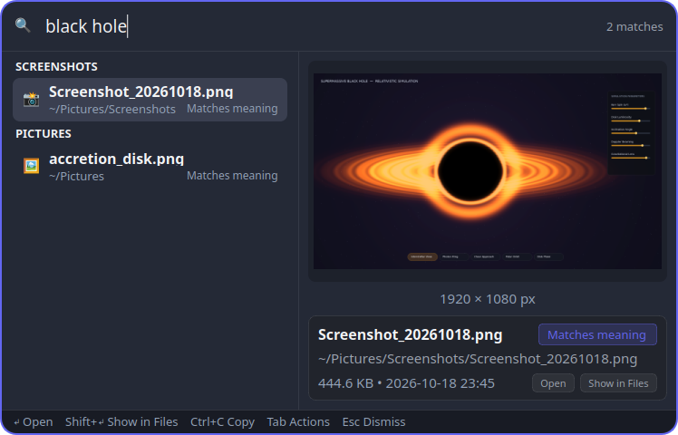
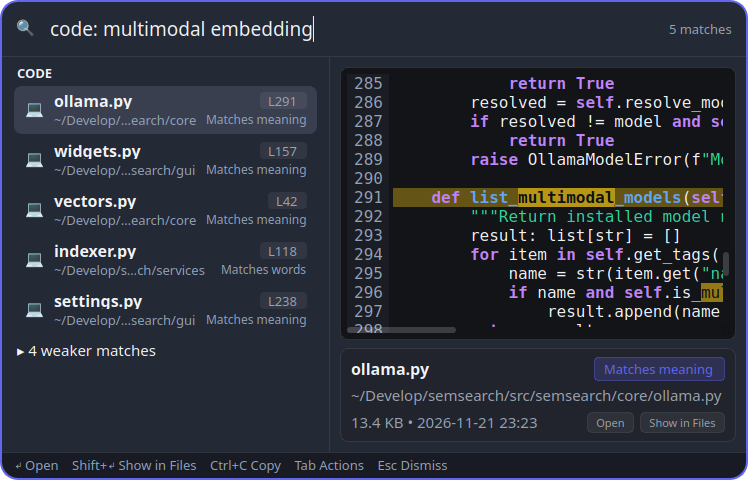

# Desktop UI, Quick Panel, Previews & Desktop Providers

SemSearch provides a keyboard-first Linux desktop experience built with **PySide6**: an event-driven **System Tray Icon**, a Spotlight-style **`748px` Floating Quick Search Panel**, a modular asynchronous **`gui/preview/`** package with real in-panel media playback, **Deep-Link Desktop Actions**, and native **KDE KRunner & GNOME Shell** D-Bus search providers.

---

## 1. Event-Driven System Tray Icon (`gui/tray.py`)

`SystemTrayManager` renders a crisp HiDPI `128 × 128` (`2×` logical `64 × 64`) antialiased `QPixmap` via `QPainter` (`render_tray_icon`):

| State | Visual Indicator | Tooltip / Menu Status |
| :--- | :--- | :--- |
| **Idle** | Brand purple-blue magnifying glass icon | `SemSearch - Idle - {N} indexed` |
| **Indexing** | Circular dark track with green progress arc (`0%`–`100%`) and center dot | `SemSearch - Indexing: {percent}% ({indexed}/{total})` |
| **Paused / Waiting** | Amber circle with dual vertical pause bars | `Paused`, `Waiting for Ollama`, `Waiting for AC power`, or `Waiting for scheduled hours` |

* **Zero Polling in `IDLE`**: When `IndexService` transitions to `IDLE`, `SystemTrayManager` stops its 1-second `QTimer` completely and only resumes polling when `IndexService.add_work_listener` signals `_work_arrived` from a background thread. `_last_rendered_state` skips redundant repaints and D-Bus updates whenever state is unchanged.
* **No-Tray Desktop Fallback**: If `QSystemTrayIcon.isSystemTrayAvailable()` is `False` (e.g., minimal tiling window managers without a tray) and `--daemon` was not specified, SemSearch automatically displays the Quick Search Panel on launch.

### Tray Interactions
* **Left-Click**: Opens and focuses the floating **Quick Search Panel**.
* **Right-Click Context Menu**: Status line *(read-only)*, **Quick Search**, **Pause Indexing / Resume Indexing** (manual user pause independent of `PowerScheduler`), **Settings...**, and **Quit**.

---

## 2. Floating Quick Search Panel (`gui/panel.py`)

Pressing <kbd>Ctrl</kbd>+<kbd>Shift</kbd>+<kbd>Space</kbd> (or running `semsearch --toggle` / `semsearch --panel`) opens a frameless floating panel (`748px` wide, `18px` corner radius, `56px` collapsed) centered in the upper third of the **monitor under the active mouse cursor** (`QApplication.screenAt(QCursor.pos())`). When matches exist, it expands up to `480px` (clamped to `screen.availableGeometry().height() - 40` on small/HiDPI displays) into a two-column layout: **`328px` result list** + **`416px` preview pane**.

### Dual-Cadence Retrieval & Selection Preservation
1. **Instant Lexical Pass**: On every keystroke, `SearchPanel` delegates to `SearchService.lexical_search(query, limit=50)` (supporting inline filters `code:`, `kind:`, `ext:`, `path:`, `after:` with zero Ollama calls).
2. **Debounced Semantic Pass (`SearchWorker`)**: After a **120 ms** pause, a background `QThread` executes `SearchService.search(..., prefix_last=True)` serialized by `_search_lock`, skipping obsolete cancelled workers immediately.
3. **Selection Preservation**: When asynchronous semantic results arrive or when toggling weaker matches, `_populate_list()` preserves the user's currently highlighted `hit.path` instead of snapping back to row 0.

### Grouped Results, Drag & Drop, Quick Actions & Accessibility
* **Category Headers & Badges**: Ranked hits group under uppercase category headers (`DOCUMENTS`, `PDF DOCUMENTS`, `SCREENSHOTS`, `PICTURES`, `AUDIO`, `MEDIA`, `CODE`) with elided paths and location badges (`p. {page}`, `M:SS`, `L{line}`). Lower-scoring hits (`< 50%` of top score) fold into an expandable `{arrow} {count} weaker matches` row.
* **Drag & Drop (`DraggableResultList`)**: Drag any result row directly into a browser, chat window, editor, or file manager (`QDrag` carrying `QUrl.fromLocalFile(hit.path)` and plain path text).
* **Quick Actions Menu (<kbd>Tab</kbd> / <kbd>Ctrl</kbd>+<kbd>K</kbd>)**: Opens a context menu on the highlighted result with **Open**, **Show in Files**, **Copy File**, **Copy Path**, **Copy Excerpt**, and **Open Terminal Here** without dismissing the panel.
* **IME, Accessibility & RTL**: `WindowDeactivate` ignores active popups (`QApplication.activePopupWidget()`) and the Quick Actions menu so `IBus`/`Fcitx5` IME windows do not close the panel. Result rows expose `Qt.ItemDataRole.AccessibleTextRole`, muted text (`#94A3B8`) meets WCAG AA contrast, and RTL locales (`ar`, `fa`, `he`) flip list borders and collapse arrows automatically.

### Keyboard Shortcuts

| Shortcut | Action |
| :--- | :--- |
| <kbd>Ctrl</kbd> + <kbd>Shift</kbd> + <kbd>Space</kbd> | Toggle Quick Search Panel globally (Wayland XDG Portal / X11 `pynput`) |
| <kbd>↑</kbd> / <kbd>↓</kbd>, <kbd>PageUp</kbd> / <kbd>PageDown</kbd>, <kbd>Home</kbd> / <kbd>End</kbd> | Navigate results and weaker matches |
| <kbd>Enter</kbd> (`↵`) | Open selected result at exact PDF page, media timestamp, or code line |
| <kbd>Shift</kbd> + <kbd>Enter</kbd> / <kbd>Ctrl</kbd> + <kbd>Enter</kbd> | Reveal and highlight file in system file manager |
| <kbd>Tab</kbd> / <kbd>Ctrl</kbd> + <kbd>K</kbd> | Open Quick Actions menu |
| <kbd>Ctrl</kbd> + <kbd>C</kbd> | Copy selected query text if highlighted in the search box; otherwise copy the file to the clipboard |
| <kbd>Alt</kbd> + <kbd>←</kbd> / <kbd>Alt</kbd> + <kbd>→</kbd> | Navigate to previous / next page when previewing a PDF |
| <kbd>Esc</kbd> | Clear search input (collapsing panel) or dismiss panel if empty |

---

## 3. Modular Asynchronous Preview Pane (`gui/preview/`)

The preview subsystem is split into a modular asynchronous package (`__init__.py`, `loader.py`, `metadata.py`, `image_view.py`, `pdf_view.py`, `media_view.py`, `code_view.py`) backed by `PreviewLoader` (`QThreadPool`, max 2 threads) with per-channel request IDs that discard stale loads as you navigate quickly:

* **Disk Thumbnail Cache (`loader.py`)**: Extracted `ffmpeg` video frames are cached atomically as PNGs in `~/.cache/semsearch/thumbs/` (pruned to the 200 most recent files by `mtime`). Text/code previews truncate safely at **256 KB** (`MAX_PREVIEW_TEXT_BYTES = 262,144`).
* **Image, SVG & Animated GIF Preview (`image_view.py`)**: Uses `QImageReader` scaled decode with `devicePixelRatioF()` for crisp HiDPI rendering (loading images `> 512 KB` asynchronously), rasterizes `.svg` vectors via PyMuPDF, plays animated `.gif` files via `QMovie`, and displays pixel dimensions.
* **PDF Preview (`pdf_view.py`)**: Renders the matched page at `1.6 × dpr` zoom using PyMuPDF with yellow keyword highlights, **◀ Prev** / **Next ▶** controls (<kbd>Alt</kbd>+<kbd>←</kbd> / <kbd>Alt</kbd>+<kbd>→</kbd>), and clear error messages for missing, encrypted, or corrupt PDFs.
* **Audio & Video Preview (`media_view.py`)**:
  * **In-Panel Audio Playback**: `AudioPreviewWidget` plays directly inside the panel using `QMediaPlayer` + `QAudioOutput` positioned at `hit.loc` (with `open_media_at` fallback), displays a real 64-bar RMS amplitude envelope (`WaveformWidget`) decoded via `ffmpeg`, and reads real duration from `hit.info["duration"]` / `probe_media_duration()` / `durationChanged`.
  * **Async Video Scrubbing**: `VideoPreviewWidget` displays cached video frames asynchronously, updates frames with a 150 ms debounce as you scrub the slider, and launches external playback via **▶ Open at Moment**.
* **Code & Document Preview (`code_view.py`)**: Read-only `CodeEditor` with dynamic `LineNumberGutter`, lightweight lexical **`CodeSyntaxHighlighter`** (keywords, definitions, strings, comments), UTF-16-safe diacritic-insensitive query highlights capped at **200** `ExtraSelection`s, async loading for files `> 128 KB`, full-width anchor highlight when `line > 0`, and line-wrapped excerpt scrolling for document/semantic matches.
* **Metadata Card (`metadata.py`)**: Displays filename, tilde path, size, modification timestamp, translated match reason badge (`Matches meaning`, `Matches words`, `Matches name`), and **Open** / **Show in Files** buttons—where **Open** dispatches `execute_hit_action(hit, config)` to preserve exact page, timestamp, or line jumps.

---

## 4. Deep-Link Desktop Actions (`services/actions.py`)

| Action | Behavior & Supported Linux Applications |
| :--- | :--- |
| **Source Code (`open_code_at`)** | Jumps to `hit.focus` or `hit.loc`: **VS Code** (`code -g path:line`), **Cursor** (`cursor -g path:line`), **Zed** (`zed path:line`), **Sublime Text** (`subl path:line`), **JetBrains** (`pycharm`/`idea`/`clion`/`webstorm`/`goland`/`rustrover`/`rider --line line path`, prioritized when `code_editor = "jetbrains"`), fallback `xdg-open`. |
| **PDF (`open_pdf_at`)** | Queries default XDG handler (`xdg-mime query default application/pdf`) and prefers it among **Papers** (`papers -i page -- path`), **Okular** (`okular -p page -- path`), **Evince** (`evince -i page -- path`), and **Zathura** (`zathura -P page -- path`), fallback `xdg-open`. |
| **Audio / Video (`open_media_at`)** | Jumps to matched second: **mpv** (`mpv --start=sec -- path`), **VLC** (`vlc --start-time=sec -- path`), fallback `xdg-open`. |
| **Reveal in File Manager** | Invokes `org.freedesktop.FileManager1.ShowItems([file_uri], "")` over **`PySide6.QtDBus.QDBusInterface`**, falling back to `dolphin`/`nautilus`/`nemo --select` and `xdg-open` on parent folder. |
| **Clipboard (`copy_file_to_clipboard`, `copy_to_clipboard`)** | Uses native Qt `QGuiApplication.clipboard()` (`QMimeData.setUrls` + `file://` URI text for files) in GUI mode, with `wl-copy` / `xclip -selection clipboard` fallback in headless CLI mode. |
| **Open Terminal Here (`open_terminal_at`)** | Opens the first available terminal in `xdg-terminal-exec`, `kitty`, `alacritty`, `ghostty`, `konsole`, `gnome-terminal`, `wezterm`, `xfce4-terminal`, `xterm` at the file's directory. |

---

## 5. Native Desktop Search Providers (`gui/desktop_providers.py`)

While SemSearch is running, `DesktopSearchProviders` registers **`org.semsearch.DesktopSearch`** on the D-Bus session bus using `QDBusVirtualObject` instances (installed with `semsearch install-desktop`):

* **KDE Plasma KRunner (`/krunner` — `org.kde.krunner1`)**: Implements `Actions` (exposing secondary action *Show in Files*), `Match` (returning up to 10 ranked hits with category, folder + excerpt subtext, and normalized relevance), and `Run` (executing deep-link `execute_hit_action` or `reveal_in_file_manager`).
* **GNOME Shell Overview (`/org/semsearch/SearchProvider` — `org.gnome.Shell.SearchProvider2`)**: Implements `GetInitialResultSet`, `GetSubsearchResultSet`, `GetResultMetas`, `ActivateResult` (deep-link open), and `LaunchSearch` (opening the SemSearch Quick Panel pre-filled with the GNOME Overview query).
